## Briefing & concept

In het vak Grafische Vormgeving onderzocht je hoe je met een raster spanning, beweging en hiërarchie suggereert. In Motion zette je reeds letters en woorden in beweging. In deze opdracht breng je **grafische ontwerpprincipes of Gestalt-principes** tot leven via een geometrische animatie in Adobe After Effects.

Werk naar onderstaand voorbeeld een Instagram reel uit in After Effects. Bedenk hoe een eenvoudige vorm door beweging, schaal en herhaling een grafisch principe overbrengt.


[Bron: Instagram Design Principles door @millmotion](https://www.instagram.com/reels/DQEx96lkaTX/)

Je kiest **3 van de 17 onderstaande designprincipes** en vertaalt deze naar een verticale video in **Instagram Reel-formaat (9:16 / 1080 × 1920 px)** van **maximaal 15 seconden** (ongeveer 5 seconden per principe). Je vertrekt vanuit één geometrische basisvorm (zoals een cirkel of vierkant) die zich ordent binnen een strak grid van 4 kolommen en 8 rijen.

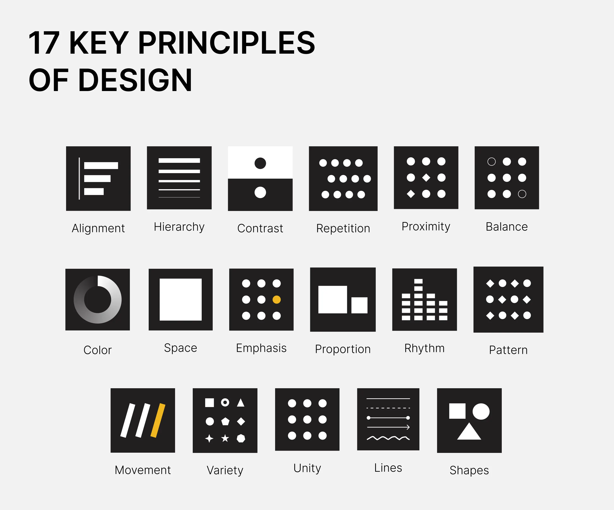

**Alignment** (Uitlijning), **Hierarchy** (Hiërarchie), **Contrast** (Contrast), **Repetition** (Herhaling), **Proximity** (Nabijheid), **Balance** (Balans), **Color** (Kleur), **Space** (Ruimte), **Emphasis** (Nadruk), **Proportion** (Proportie), **Rhythm** (Ritme), **Pattern** (Patroon), **Movement** (Beweging), **Variety** (Variatie), **Unity** (Eenheid), **Lines** (Lijnen), **Shapes** (Vormen)


[Pinboard met extra infographics over de verschillende design principes.](https://www.pinterest.com/vincentvandercruyssen/kinetic-gestalt/)

Gestalt komt uit het Duits en betekent ‘vorm’, ‘gedaante’ of ‘georganiseerd geheel’. Aan het begin van de twintigste eeuw werkten psychologen de [gestaltpsychologie](https://nl.wikipedia.org/wiki/Gestaltpsychologie) uit. De kern is dat ons brein een visuele prikkel meteen organiseert tot één compleet, herkenbaar geheel dat meer betekenis heeft dan alleen de losse onderdelen. Het geheel is meer dan de som der delen.

## Stappenplannen

### Schetsboek & voorbereiding

Voor je After Effects opstart, werk je het concept en de opbouw van je drie principes uit in je schetsboek.

1. **Paginatitel:** Noteer bovenaan je blad **Storyboard Gestalt in After Effects**.
2. **Drie principes & toelichting:** Noteer je drie gekozen ontwerpprincipes / Gestalt-principes. Noteer per principe in eigen woorden:
   * Wat houdt dit principe in, wat betekent het? (1 à 2 zinnen)
   * Hoe laat je dit zien via beweging in een grid?
3. **Vorm & kleur:** Kies één geometrische basisvorm (cirkel, vierkant...) en één duidelijke contrastkleur die je toepast op de drie ontwerpprincipes. Bepaal ook je achtergrondkleur.
4. **Titel & uitlijning:** Schrijf links boven elk blok rasters de naam van het bijhorende principe, *Designprincipes* rechtsonder.
5. **Rasters schetsen:** Teken voor elk principe minimaal twee strakke rasters van **4 kolommen bij 8 rijen** (32 modules): kader 1 voor de beginpositie en kader 2 voor het eindresultaat.
6. **Bewegingspijlen & timing:** Schets in stappen hoe de vormen bewegen van hun beginpositie naar het eindresultaat.

Voor sommige principes kunnen bijvoorbeeld ook vul- en lijnkleur of lijndikte veranderen, ook dit kun je schetsen.

### Uitwerking in After Effects

#### Compositie & projectinstellingen

1. Start After Effects en kies **File > New > New Project**.
2. Maak een nieuwe compositie via **Composition > New Composition...** (`Ctrl + N`).
3. Stel de compositie als volgt in:
   * **Composition Name:** `VoornaamA_Gestalt`
   * **Width:** `1080 px`
   * **Height:** `1920 px` (9:16 staand formaat voor Instagram Reels)
   * **Frame Rate:** `30 fps`
   * **Duration:** `0:00:15:00` (15 seconden, max. 5 seconden per principe)
4. Bevestig met **OK**.

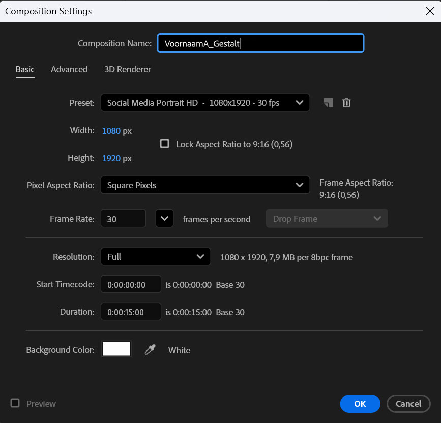

#### Werkruimte & raster (Grid)

Zorg voor een gestructureerde werkruimte en activeer het lay-outrooster:

1. Klik in de menubalk op **Window > Workspace > All Panels** om alle nodige vensters binnen handbereik te hebben.
2. Schakel het raster in via **View > Show Grid** (`Ctrl + '`).

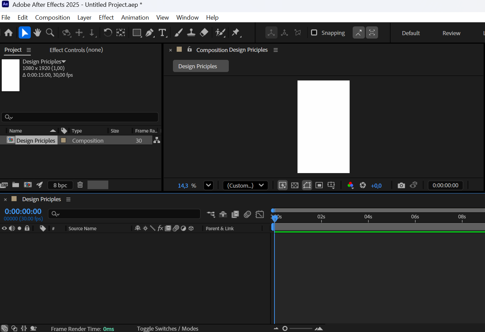

3. Ga in het bovenmenu naar **Edit > Preferences > Grids & Guides** (op macOS: **After Effects > Settings > Grids & Guides**).


4. Stel het raster in onder de sectie *Grid*:
   * **Gridline every:** `40 px`
   * **Subdivisions:** `1`
5. Bevestig met **OK**. Je ziet nu een strak raster met lijnen om de 40 px op je canvas.

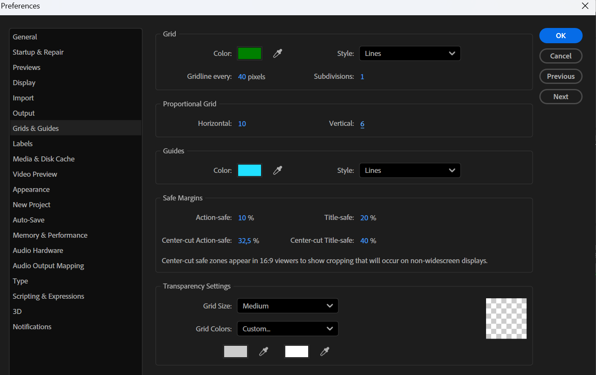

#### Marges & hulplijnen

Gebruik hulplijnen (*guides*) om de marges van je compositie af te bakenen:

Zorg dat de linialen zichtbaar zijn via **View > Show Rulers** (`Ctrl + R`). Controleer de exacte pixelwaarden van je hulplijn tijdens het slepen in het paneel **Info** (`Window > Info`).

##### Breedteverdeling (links & rechts)
* Sleep vanuit de linkse liniaal een hulplijn naar de linkermarge: `160 px` (X).
* Sleep een tweede hulplijn naar de rechtermarge: `920 px` (X, zodat rechts eveneens 160 px marge overblijft).
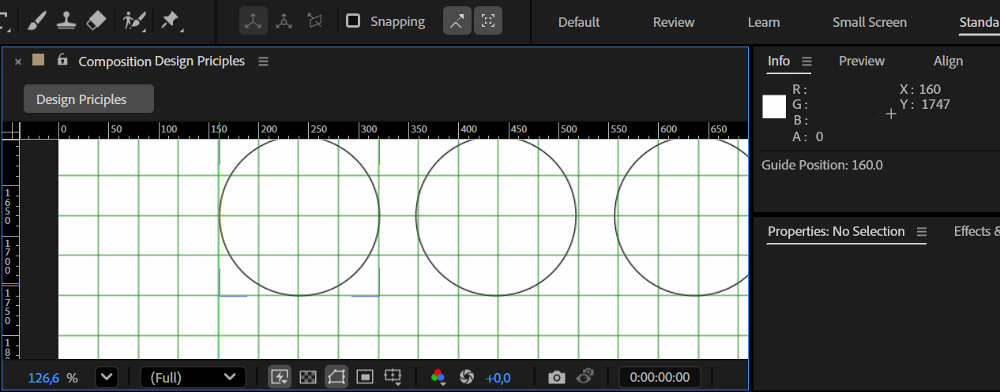

##### Hoogteverdeling (boven & onder)
* Sleep vanuit de bovenste liniaal een hulplijn naar de bovenmarge: `200 px` (Y).
* Sleep een hulplijn naar de ondermarge: `1760 px` (Y, zodat onderaan 160 px marge overblijft).

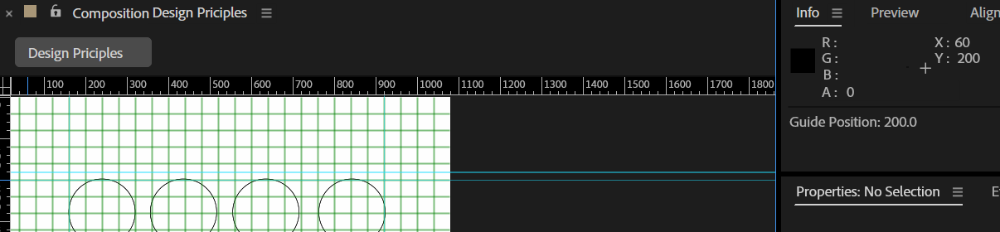

#### Patroon opbouwen met basisvormen

Bouw het modulaire patroon van 4 kolommen bij 8 rijen op met exacte afmetingen:

1. Selecteer de **Ellipse Tool (`Q`)** (of Rectangle Tool) in de bovenste werkbalk.

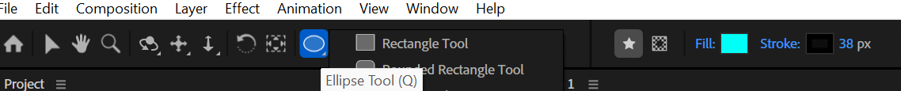

2. Houd `Shift` ingedrukt en sleep op het canvas een basisvorm.
3. Klap in de tijdlijn de aangemaakte vormlaag open naar **Contents > Ellipse 1 > Ellipse Path 1 > Size**.
4. Stel zowel de breedte als de hoogte exact in op **`160 px`**. Dit geeft een cirkel met een diameter van exact 160 px.

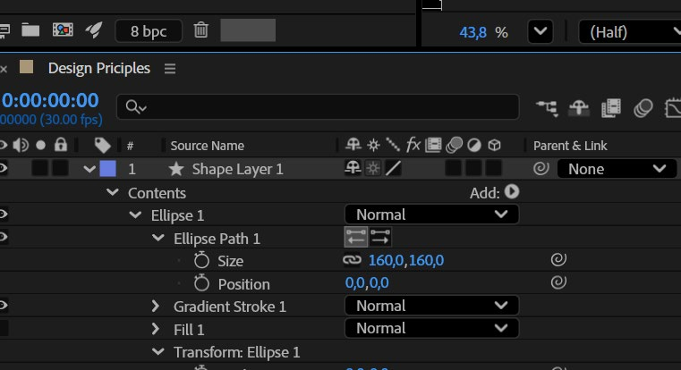

5. Dupliceer deze vorm (`Ctrl + C` en `Ctrl + V`, of selecteer en dupliceer met `Ctrl + D`) en schuif hem opzij:
   * Zorg voor een tussenruimte (*gutter*) van exact **40 px** tussen de cirkels.
   * Maak op deze manier een volledige rij van **4 cirkels**.
6. Selecteer de 4 cirkels van de eerste rij, kopieer ze en plak ze naar beneden.
7. Herhaal dit tot je een uniform raster hebt van **8 rijen van 4 cirkels** (32 vormen in totaal).

#### Patroon uitlijnen & typografie

##### Wiskundige uitlijning
* Selecteer de vormen en open het venster **Align** via **Window > Align**.
* Gebruik *Distribute Horizontally* en *Distribute Vertically* om de tussenafstanden wiskundig gelijk te trekken tussen je hulplijnen.

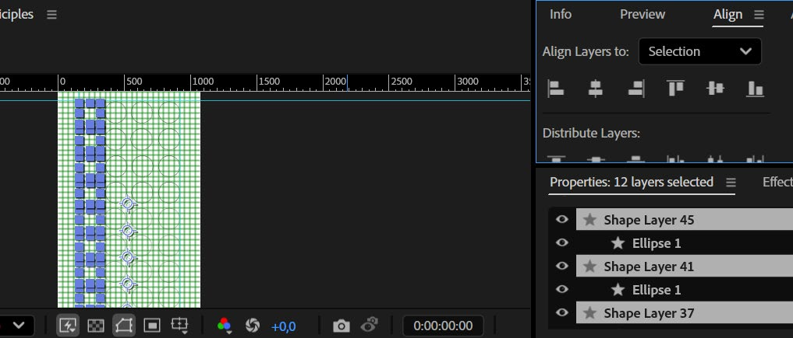

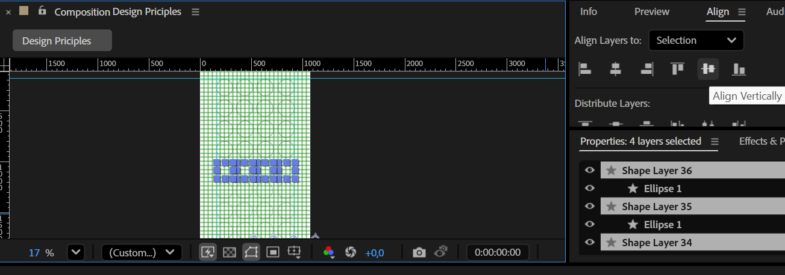

##### Typografie toevoegen
* Selecteer de **Horizontal Type Tool (`Ctrl + T`)**.
* Typ bovenaan het patroon de naam van het gekozen designprincipe (bijvoorbeeld *Contrast* of *Hierarchy*). Lijn deze tekst links uit met de linkerrand van het patroon.
* Typ onderaan het patroon de aanduiding *Designprincipes*. Lijn deze tekst rechts uit met de rechterrand van het patroon.

#### Animeren: Contents versus Transform

Bij het animeren van vormlagen (*Shape Layers*) in After Effects is het onderscheid tussen de twee hoofdgroepen Contents en Transform essentieel.

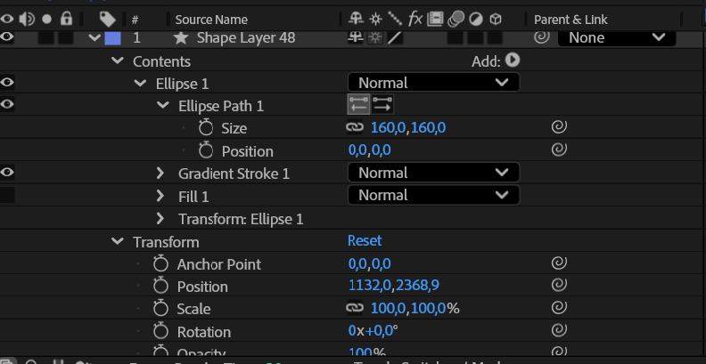

* **Contents:** Bevat de eigenschappen van de individuele vectorvorm (*Ellipse Path > Size*, *Fill*, *Stroke*).
  * `Contents > Ellipse Path > Size`: Past de afmeting van de vorm zelf aan. De cirkel wordt groter of kleiner zonder dat de laag of het ankerpunt verschuift.
* **Transform:** Bevat de algemene instellingen voor de complete laag (*Anchor Point*, *Position*, *Scale*, *Rotation*, *Opacity*).
  * `Transform > Scale`: Schaalt de gehele laag proportioneel, inclusief eventuele lijndiktes en effecten.

Kort: Contents verandert de vorm, Transform verandert de laag.

#### Keyframes & overgangen

1. Plaats de tijdindicator op frame `00:00`.
2. Klik op de **stopwatch** naast de eigenschappen die je wilt animeren (bijvoorbeeld *Size*, *Position*, *Rotation* of *Opacity*). Er verschijnt een eerste keyframe op de tijdlijn.

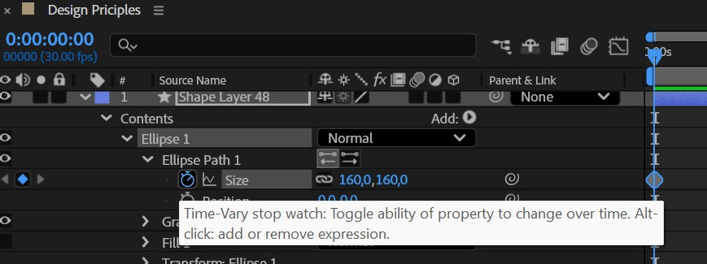

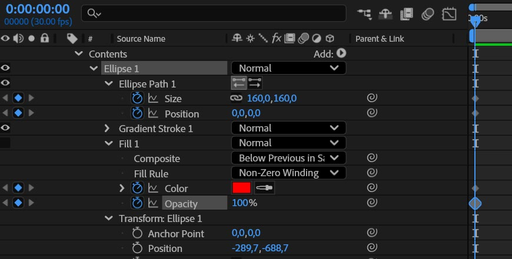

3. Wil je dezelfde animatie toepassen op andere cirkels in je grid?
   * Selecteer de keyframes op de tijdlijn.
   * Kopieer ze via `Ctrl + C`.
   * Selecteer de gewenste parameter bij de andere vormlagen en plak met `Ctrl + V`.

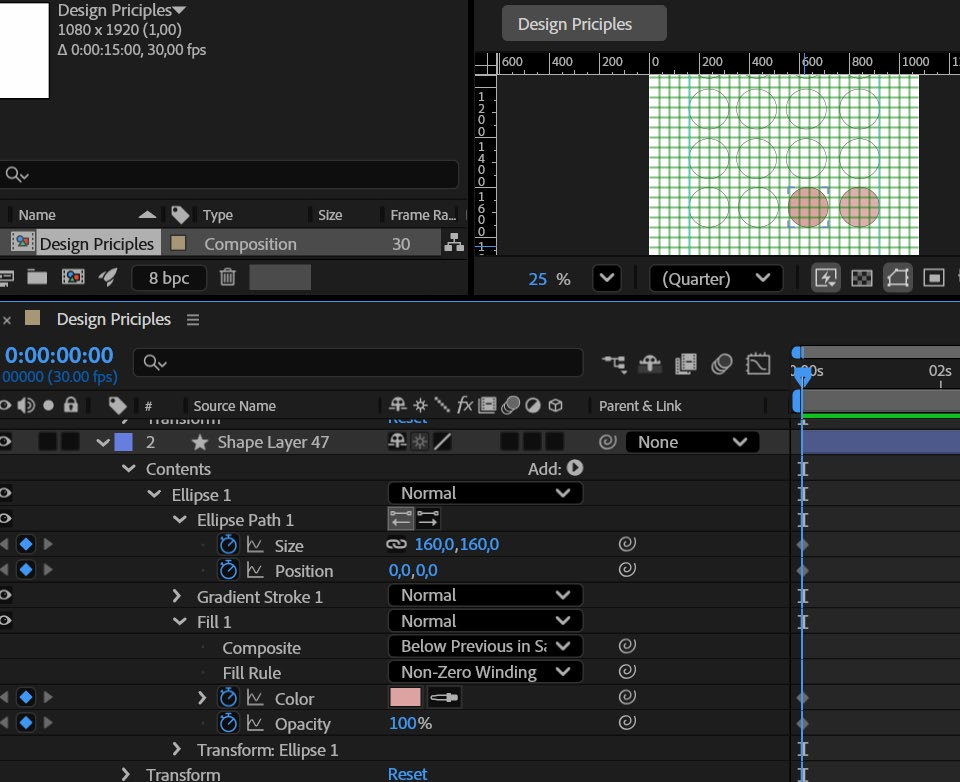

4. Verplaats de tijdindicator naar een volgend tijdstip (bijvoorbeeld 2 of 3 seconden verder).
5. Pas de waarde van de eigenschap aan op de vormlaag. After Effects genereert automatisch een nieuw keyframe en berekent een vloeiende overgang.

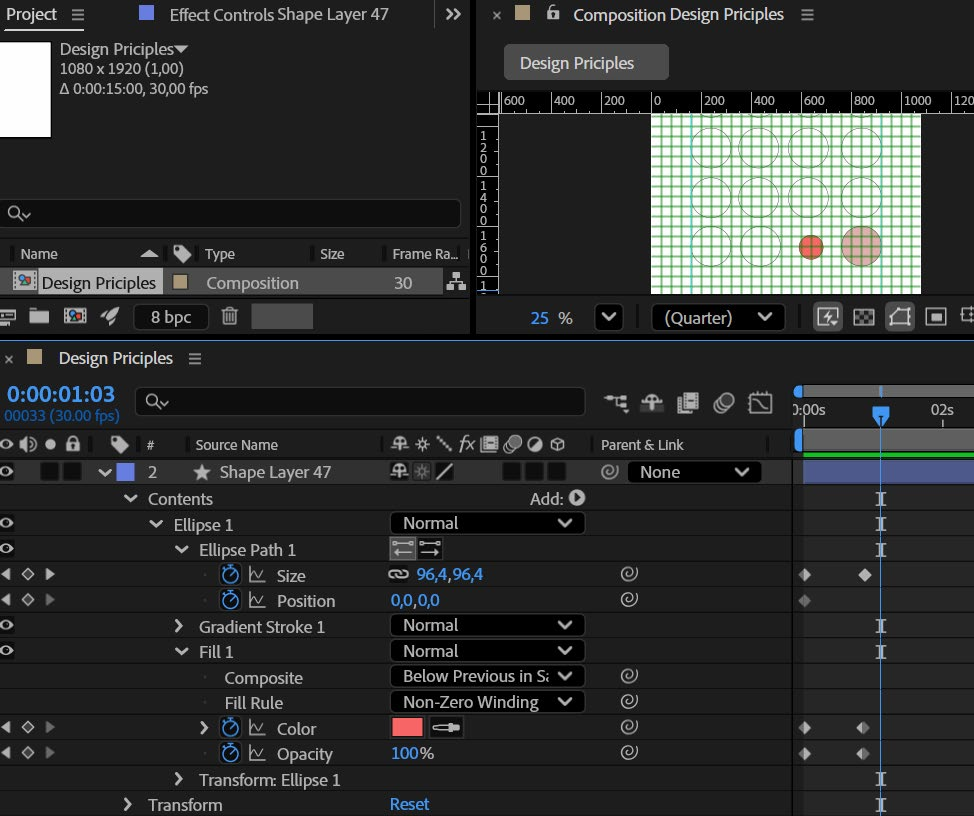

6. Speel de compositie af met de **spatiebalk** om de timing te controleren. Druk op `Esc` of opnieuw op de **spatiebalk** om te stoppen.
7. Bouw achtereenvolgens je **3 gekozen designprincipes** op in de tijdlijn. Zorg voor een heldere visuele overgang tussen de fases (maximaal 5 seconden per principe).

#### Vloeiende beweging met Easy Ease

Standaard zijn keyframes lineair en mechanisch. Maak de bewegingen natuurlijker en organischer door gebruik te maken van **Easy Ease**.



1. Selecteer alle geplaatste keyframes door er een selectiekader omheen te slepen.
2. Ga in het bovenmenu naar **Animation > Keyframe Assistant > Easy Ease** (of druk direct op **`F9`**). De keyframes veranderen in zandlopers.
3. De beweging start nu rustig op, versnelt in het midden en vertraagt zacht bij het eindpunt.

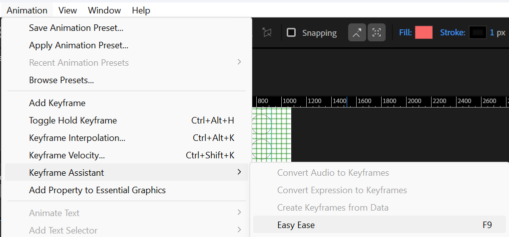

4. **Timing finetunen:**
   * Sleep keyframes dichter bij elkaar om een actie sneller en krachtiger te maken.
   * Schuif keyframes verder uit elkaar voor een rustige, gedragen beweging.

#### Exporteren naar MP4

Wanneer je animatie klaar is en vloeiend afspeelt, exporteer je de video via **Adobe Media Encoder**:

1. Selecteer de compositie `VoornaamA_Gestalt` in het *Project-paneel*.
2. Kies in het menu **Composition > Add to Adobe Media Encoder Queue...** (`Ctrl + Alt + M`).

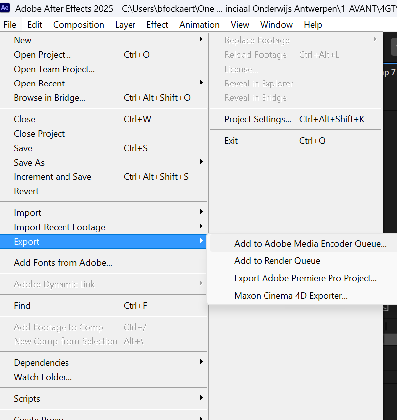

3. In Adobe Media Encoder verschijnt je compositie in de renderwachtrij:
   * Stel het **Formaat** in op **H.264**.
   * Kies als voorinstelling **Match Source - High Bitrate**.

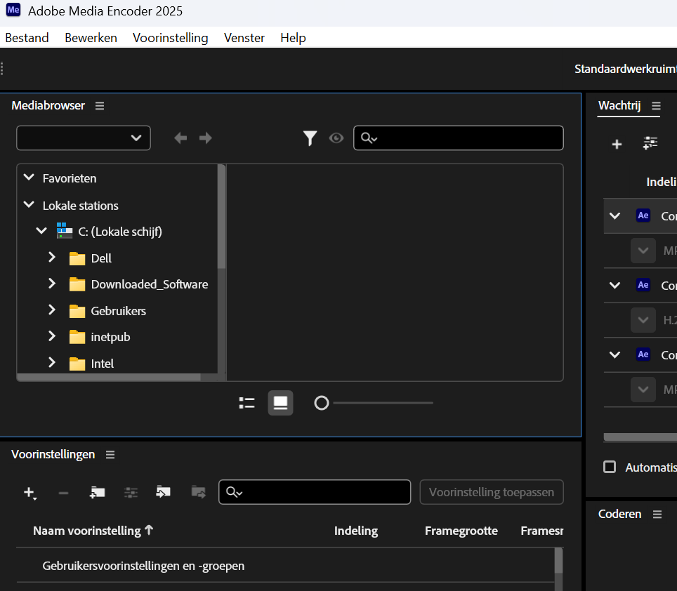

4. Klik op de blauwe tekst onder *Output File*, navigeer naar de map `02_exports/` binnen je project en sla het bestand op als:
   `VoornaamA_Gestalt.mp4`
5. Klik op de groene **Play-knop** (`Enter`) in de rechterbovenhoek om de export te starten.

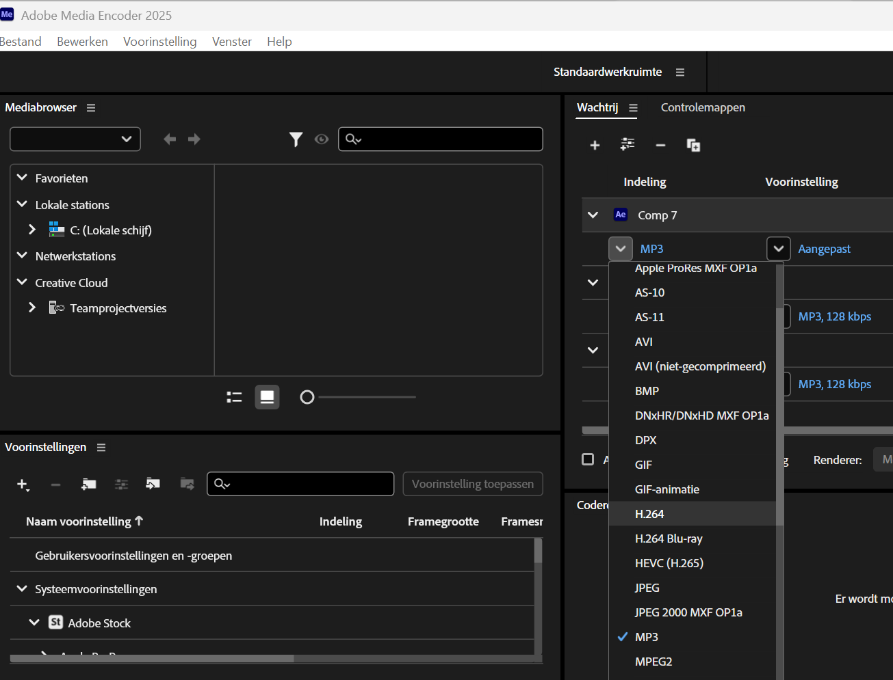

## Oplevering

Pak je volledige projectmap in als een zip-archief en dien in via de voorziene Smartschool-uploadzone:

```text
VoornaamA_Gestalt.zip
└─ 01_assets/
   └─ VoornaamA_Storyboard-Gestalt.jpg
└─ 02_exports/
   └─ VoornaamA_Gestalt.mp4
└─ VoornaamA_Gestalt.aep
```

### Checklist

Controleer je werk grondig aan de hand van onderstaande criteria voor je het archief uploadt.

#### Bestanden & mappen
- Het zip-bestand en de hoofdmap dragen de exacte naam `VoornaamA_Gestalt.zip`.
- De map `01_assets/` bevat een duidelijke foto of scan van je schetsboekpagina (`VoornaamA_Storyboard-Gestalt.jpg`) met het 4×8 grid en de visualisaties van de drie principes.
- Het After Effects-projectbestand `VoornaamA_Gestalt.aep` staat netjes in de hoofdmap.
- De map `02_exports/` bevat de geëxporteerde videorender `VoornaamA_Gestalt.mp4`.

#### Technische specificaties
- De compositie staat ingesteld op **1080 × 1920 px (9:16 Full HD portretformaat)**.
- De framerate is exact ingesteld op **30 fps**.
- De totale videoduur is maximaal **15 seconden** (circa 5 seconden per ontwerpprincipe).
- De MP4-video is geëxporteerd met de **H.264** codec via Adobe Media Encoder en speelt vloeiend af.

#### Vormgeving & principes
- Je hebt bewust 3 principes gekozen uit de lijst van 17 designprincipes.
- Elk principe is herkenbaar en visueel duidelijk vertaald via de kinetische beweging van het patroon.
- Het onderliggende grid van **4 kolommen × 8 rijen** is wiskundig correct opgebouwd met gelijke tussenafstanden (marges 160 px links/rechts/onder, 200 px boven; vormdiameter 160 px; gutter 40 px).
- Typografie bovenaan en onderaan het patroon is strak uitgelijnd met de randen van het raster.
- Alle bewegingen zijn voorzien van **Easy Ease (`F9`)** voor vloeiende versnelling en vertraging.
