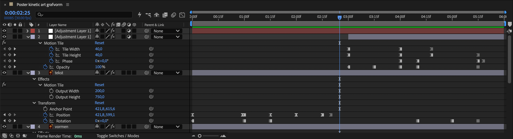
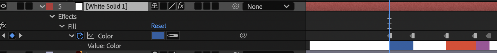
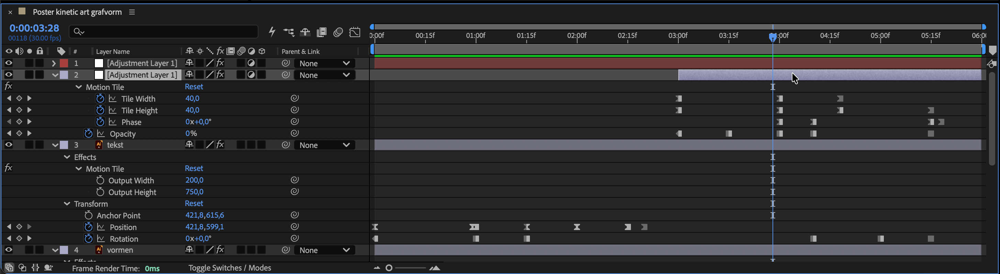
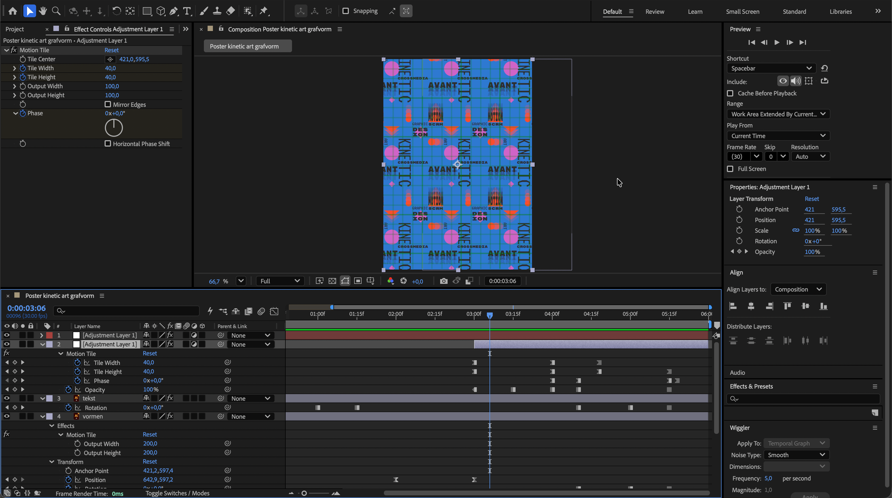

## Briefing & concept

Bij het vak **Grafische vormgeving** ontwierp je vanuit een strak grid een **Kinetic Art poster** in **Adobe Illustrator**. Met verschillende geometrische vormen in een sterk kleurenpalet en schreefloze typografie suggereerde je al beweging op een stilstaand vlak via herhaling, ritme, richting en overlapping.

In deze opdracht wek je jouw eigen poster tot leven in **Adobe After Effects**. Je bouwt je statische ontwerp om tot een **blitsende, aantrekkelijke en naadloze reel of GIF-loop van ongeveer 6 seconden**.





### Stop-motiongevoel & eindeloze patronen

In plaats van enkel zachte overgangen zoek je in deze animatie bewust de spanning op tussen **abrupte sprongen** en **versnellingen**:

* **Stop-motiongevoel:** Door **Toggle Hold Keyframes** (directe sprong van het ene keyframe naar het andere zonder tussenliggende beweging) af te wisselen met **Easy Ease (`F9`)**, krijgt je affiche een schokkerig, energiek en grafisch ritme.
* **Eindeloze lagen:** Met het effect **Motion Tile** laat je jouw tekst- en vormlagen eindeloos buiten het kader doorlopen, zodat je hun positie, rotatie en schaal kunt animeren zonder afgekapte randen.
* **Optische tegelpatronen & kleurflitsen:** Bovenop je ontwerp experimenteer je met een **Adjustment Layer** voorzien van *Motion Tile* (*Tile Width*, *Tile Height* en *Phase*). 
* Laat een **Solid**-achtergrondkleur op krachtige accenten mee van kleur verspringen.

### Technische specificaties

Je werkt je animatie uit in een compositie genaamd **`VoornaamA_Poster`** op een staand formaat van **`1240 × 1754 px`** (de helft van een A4 op drukresolutie). Stel de framerate in op **`30 fps`** en mik op een korte, punchy doorlopende loop van ongeveer **6 seconden**. Aan het einde exporteer je het resultaat naar een **`H.264 MP4`**.

### Mappenstructuur

Zet vooraf een ordelijke mappenstructuur op in je OneDrive onder het vak **Motion**:

```text
VoornaamA_Poster/
└─ 01_assets/        <- Gelaagd Illustrator-bestand (.ai) en eventuele fonts of audio
└─ 02_exports/       <- Definitieve reel (.mp4) en geanimeerde loop (.gif)
└─ VoornaamA_Poster.aep
```

## Stappenplan

### Voorbereiding in Illustrator

Een vlotte animatie in After Effects begint bij een goed voorbereid vectorbestand. Bewaar een kopie van je afgewerkte poster in je map `01_assets/` (bijvoorbeeld `VoornaamA_PosterKinetic.ai`):

1. **Werk met aparte hoofdlagen:** After Effects zet enkel de bovenste laaghiërarchie (*top-level layers*) om naar afzonderlijke lagen op je tijdlijn. Controleer of typografie, geometrische vormen en je eventuele grid van elkaar gescheiden zijn en geef elke laag een duidelijke naam (zoals `tekst`, `vormen` en `grid`, of splits losse woorden en vormgroepen verder op voor meer bewegingsvrijheid).
2. **Stel je lettertypes veilig:** Activeer je gebruikte lettertype via [Adobe Fonts](https://fonts.adobe.com/) of zet de tekst in deze kopie voor Motion om naar letteromtrekken (**Type > Create Outlines** / `Ctrl + Shift + O`), zodat er nooit een lettertype ontbreekt.
3. **Verberg een vast achtergrondvlak:** Heb je in Illustrator een witte achtergrondrechthoek getekend? Verwijder of verberg deze laag, want de achtergrondkleur bouw en animeer je straks rechtstreeks in After Effects.

### Importeren als compositie & formaat aanpassen

#### Illustrator-bestand importeren met behoud van lagen

1. Start **Adobe After Effects** en sla je lege project meteen op in je hoofdmap als `VoornaamA_Poster.aep`.
2. Ga naar **File > Import > File...** (`Ctrl + I` / `Cmd + I`) en selecteer jouw `.ai`-posterbestand uit `01_assets/`.
3. Stel de opties in het importvenster als volgt in (zie ook de [Cursus After Effects: Illustrator importeren](/cursus/after_effects/#bestanden-importeren-illustrator-naar-after-effects)):
   * **Import Kind:** `Composition` *(kies niet voor Footage, anders worden al je lagen platgeslagen tot één afbeelding)*.
   * **Footage Dimensions:** `Layer Size` *(elke laag behoudt zo zijn eigen strakke selectiekader en gecentreerd ankerpunt)*.
4. Bevestig met **OK**. In het *Project-paneel* verschijnen een kant-en-klare compositie én een map met al je losse vectorlagen. Dubbelklik op de compositie om de tijdlijn te openen.


#### Compositiegrootte wijzigen naar 1240 × 1754 px

After Effects leest een A3-ontwerp uit Illustrator standaard in op puntformaat (`842 × 1191 px`). Pas de compositie aan naar **`1240 × 1754 px`** (de helft van een A4 op 300 ppi) voor een scherpe reel en loop:

1. Open **Composition > Composition Settings...** (`Ctrl + K` / `Cmd + K`).
2. Pas de parameters aan:
   * **Composition Name:** `VoornaamA_Poster`
   * **Width:** `1240 px`
   * **Height:** `1754 px`
   * **Frame Rate:** `30 fps`
   * **Duration:** `0:00:06:00` (ongeveer 6 seconden)
3. Klik op **OK**. Selecteer vervolgens je geïmporteerde lagen op de tijdlijn en pas hun positie en schaal evenredig aan zodat je poster het grotere `1240 × 1754 px` kader opnieuw volledig vult.

### Solid als geanimeerde achtergrond

Je geïmporteerde vectorlagen zweven boven een transparant canvas. Voeg een **Solid** toe als volwaardige achtergrondlaag waarvan je ook de kleur mee kunt laten bewegen:

1. Kies in de menubalk **Layer > New > Solid...** (`Ctrl + Y` / `Cmd + Y`).
2. Klik op **Make Comp Size** (`1240 × 1754 px`), kies je startkleur (bijvoorbeeld helder wit of een hoofdkleur uit je palet) en klik op **OK**.
3. Sleep deze Solid-laag helemaal **onderaan** in je tijdlijn, onder al je posterlagen (zie ook [Cursus After Effects: Solid Layer](/cursus/after_effects/#wat-is-een-solid-layer)).
4. **Kleur van je Solid animeren:**
   * Selecteer je Solid-laag en kies **Effect > Generate > Fill**.
   * Activeer in het paneel *Effect Controls* (of op de tijdlijn onder `Effects > Fill`) de **stopwatch naast Color**.
   * Plaats verderop in je tijdlijn nieuwe keyframes met felle contrastkleuren uit het kleurenpalet van je poster (zoals feloranje, kobaltblauw of diepzwart) om de hele sfeer op het ritme van de animatie te laten omslaan.



### Eindeloze lagen met Motion Tile

Zodra je een losse laag (`tekst`, `vormen` of `grid`) verschuift, draait of verkleint, botst je beeld normaal gezien op een lege, afgekapte rand. Met **Motion Tile** verleng je je lagen eindeloos buiten de compositiegrootte:

1. Selecteer een posterlaag op de tijdlijn (bijvoorbeeld `tekst` of `vormen`) en pas **Effect > Stylize > Motion Tile** toe.
2. Verhoog in het paneel *Effect Controls* de waarden **Output Width** en **Output Height** ruim boven `100` (bijvoorbeeld `200` tot `750`).
3. Je laag wordt nu naadloos herhaald tot ver voorbij de randen van je `1240 × 1754 px` canvas.
4. Open onder `Transform` de transformatie-eigenschappen en breng je lagen energiek in beweging:
   * **Position (`P`):** Laat typografie of vormbanen als een lopende band verticaal, horizontaal of diagonaal door het beeld razen.
   * **Rotation (`R`):** Kantel een laag `45°`, `90°` of `180°` zonder dat er ooit lege hoeken ontstaan.
   * **Scale (`S`):** Zoom kort uit om het oneindige patroon van je vormen of tekst te onthullen en spring of glijd daarna weer strak terug naar `100%`.


### Stop-motiongevoel: Toggle Hold en Easy Ease

De kracht van deze animatie schuilt in het contrast tussen twee tegengestelde keyframe-stijlen:

1. **Toggle Hold Keyframe (Directe sprong):**
   * Selecteer één of meerdere keyframes op de tijdlijn, klik erop met de **rechtermuisknop** en kies **Toggle Hold Keyframe** (sneltoets `Ctrl + Alt + H` / op macOS `Cmd + Option + H`).
   * Het keyframe verandert in een **vierkant blokje**.
   * **Wat gebeurt er?** After Effects schakelt alle tussenliggende berekeningen (*interpolatie*) uit. De laag blijft stil bevroren tot exact het volgende keyframe en **verspringt dan onmiddellijk** naar de nieuwe waarde. Door meerdere *Hold*-keyframes kort na elkaar te zetten (bijvoorbeeld om de vijf tot tien frames op *Position*, *Rotation*, *Scale* of *Fill Color*), creëer je een ritmisch **stop-motiongevoel**.
2. **Easy Ease (`F9`) & Graph Editor (Snappy souplesse):**
   * Zet andere overgangen om naar **Easy Ease (`F9`)** (zandloper-icoon) en trek de snelheidscurve eventueel strak aan in de *Graph Editor* (`Shift + F3`).
   * **Wissel beide bewust af:** Laat een laag bijvoorbeeld eerst in drie droge *Toggle Hold*-klappen verspringen en vervolgens met een razendsnelle *Easy Ease*-beweging doorschieten naar de volgende compositie.



### Adjustment Layer met Motion Tile

Bovenop de beweging van je afzonderlijke lagen voeg je een overkoepelende aanpassingslaag toe die het **volledige posterbeeld tegelijk** opdeelt en verschuift (zie ook [Cursus After Effects: Aanpassingslagen](/cursus/after_effects/#werken-met-aanpassingslagen-adjustment-layers)):

1. Maak een aanpassingslaag aan via **Layer > New > Adjustment Layer** (`Ctrl + Alt + Y` / `Cmd + Option + Y`) en plaats deze **helemaal bovenaan** je tijdlijn.
2. Pas hierop eveneens **Effect > Stylize > Motion Tile** toe.
3. Experimenteer met de tegelparameters en animeer ze (bij uitstek met **Toggle Hold Keyframes**):
   * **Tile Width & Tile Height:** Verklein deze waarden van `100` naar bijvoorbeeld `50`, `40` of `25`. Je volledige poster breekt plots open in een strak mozaïek van herhaalde mini-affiches.
   * **Phase:** Animeer de fase-draaischijf (bijvoorbeeld naar `90°` of `180°`) en test het vinkje **Horizontal Phase Shift**. Hiermee verschuiven afwisselende rijen of kolommen ten opzichte van elkaar voor een sterk optisch *Op Art*-patroon.
   * **Mirror Edges:** Vink optioneel aan om de aangrenzende tegels symmetrisch in elkaar te spiegelen.
4. **Doseer het effect:** Laat deze *Adjustment Layer* niet de volle zes seconden domineren, zodat je oorspronkelijke posterontwerp herkenbaar en leesbaar blijft. Kort de laag op de tijdlijn in (bijvoorbeeld pas actief vanaf halverwege je animatie) of laat de **Opacity (`T`)** met *Toggle Hold Keyframes* ritmisch aan en uit flitsen tussen `0%` en `100%`.



### Naadloze loop & exporteren

#### Een doorlopende loop opbouwen

Een sterke GIF of Reel speelt eindeloos door zonder zichtbare breuk tussen het einde en het begin, met een stop-motionstijl valt een abrupte overgang minder op.

Zorg dat elke geanimeerde eigenschap (Position, Rotation, Scale, Fill Color van je Solid en de Adjustment Layer) op tijdstip 00:00 een duidelijk beginkeyframe heeft. Bekijk meerdere herhalingen na elkaar om te controleren of het tempo goed aanvoelt en de overgang van einde naar begin sterk aansluit.

#### Exporteren naar MP4 en GIF

Render je afgewerkte loop vanuit After Effects via **Adobe Media Encoder**:

1. Selecteer je hoofdcompositie `VoornaamA_Poster` in het *Project-paneel* en kies **Composition > Add to Adobe Media Encoder Queue...** (`Ctrl + Alt + M`).
2. **MP4-export (voor Reel / video):**
   * Stel het formaat in op **H.264** met de voorinstelling **Match Source - High Bitrate** (`1240 × 1754 px`, `30 fps`).
   * Klik op het uitvoerpad en bewaar het bestand in `02_exports/VoornaamA_Poster.mp4`.
3. Klik rechtsboven op de groene **Play-knop** (`Enter`) om het bestand te exporteren.

### Extra uitdagingen

Klaar met je basisloop en zin om nog meer toe te voegen?

* **Flitsende kleurinversie (`Invert`):** Plaats een korte extra *Adjustment Layer* van slechts enkele frames lang op een hard overgangsmoment en voeg **Effect > Channel > Invert** toe voor een grafische negatief-flits.
* **Posterize Time:** Pas **Effect > Time > Posterize Time** (bijvoorbeeld ingesteld op `12` of `15` frames per seconde) toe om zelfs je vloeiende *Easy Ease*-bewegingen een tactiele, handgemaakte stop-motioncadans mee te geven.
* **Sound design op de sprongen (voor je MP4-reel):** Zoek korte mechanische kliks, papiergeluiden of een strakke elektronische beat via [Freesound](https://freesound.org/), bewaar de audio in `01_assets/`, klap de geluidsgolf open met `LL` en lijn je *Toggle Hold*-sprongen exact uit op de audiopieken.

## Oplevering

Pak je volledige projectmap in als één zip-archief en dien in via de voorziene Smartschool-uploadzone:

```text
VoornaamA_Poster.zip
└─ 01_assets/
   └─ VoornaamA_PosterKinetic.ai
└─ 02_exports/
   └─ VoornaamA_Poster.mp4
└─ VoornaamA_Poster.aep
```

### Checklist

Controleer je werk grondig aan de hand van onderstaande kwaliteitscontrole vóór je het archief indient.

#### Bestanden & mappen
- Het zip-archief en de hoofdmap heten exact `VoornaamA_Poster`.
- De map `01_assets/` bevat je gelaagde Illustrator-bronbestand (`.ai`) en eventuele losse font- of audiobestanden.
- Het After Effects-projectbestand `VoornaamA_Poster.aep` bevindt zich rechtstreeks in de hoofdmap.
- De map `02_exports/` bevat de videoreel `VoornaamA_Poster.mp4`.

#### Technische specificaties
- Het Illustrator-bestand is geïmporteerd als **Composition** met behoud van alle afzonderlijke lagen (*Layer Size*).
- De compositiegrootte staat exact ingesteld op **1240 × 1754 px** (helft A4) aan **30 fps**.
- De animatie duurt **ongeveer 6 seconden** en vormt een naadloze loop waarbij einde en begin op elkaar aansluiten.
- Helemaal onderaan de tijdlijn ligt een **Solid** op compositiegrootte als achtergrondlaag.

#### Vormgeving, Motion Tile & bewegingsritme
- Op de geanimeerde posterlagen is **Motion Tile** toegepast met verhoogde *Output Width* en *Output Height*, zodat *Position*, *Rotation* en *Scale* bewegen zonder afgekapte randen.
- Er is een doordachte afwisseling tussen **Toggle Hold Keyframes** (directe sprongen met stop-motiongevoel) en **Easy Ease (`F9`)**.
- Bovenaan de lagenstapel zorgt een **Adjustment Layer met Motion Tile** (variatie in *Tile Width*, *Tile Height* en *Phase*) op gerichte momenten voor extra visuele dynamiek.
- De achtergrondkleur van de **Solid** (via *Fill*) animeert of flitst harmonieus mee binnen het gekozen kleurenpalet.

