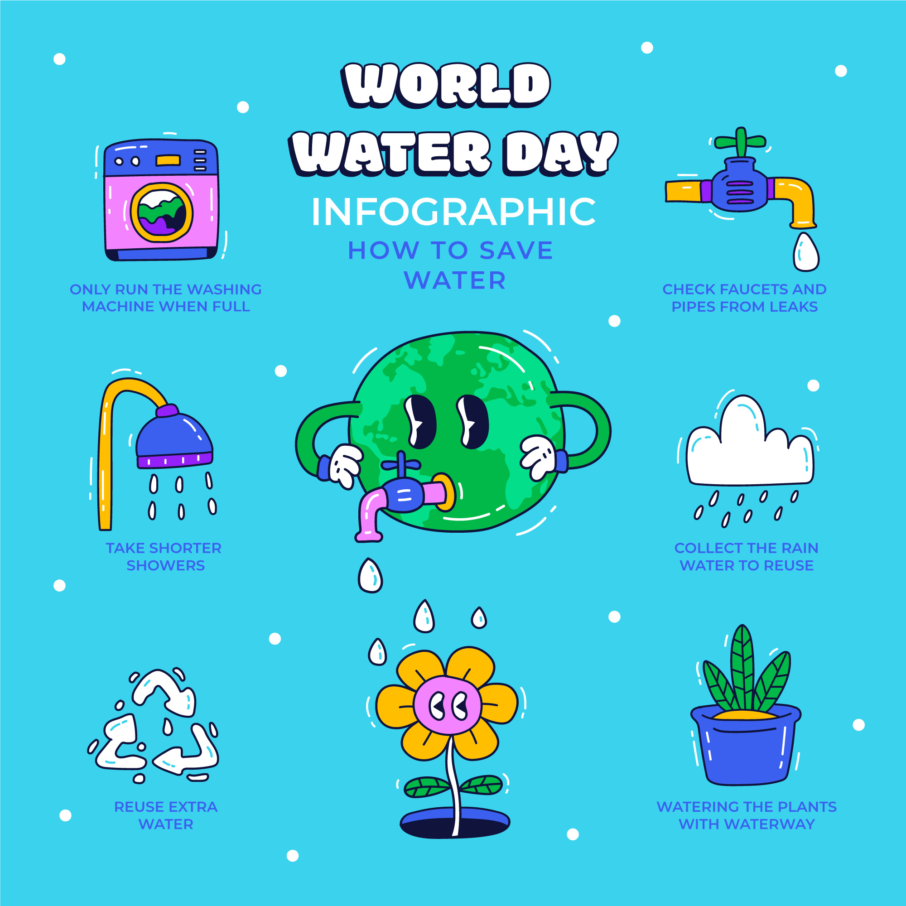

## Briefing & concept

Voor de Jeugdboekenmaand 2027 bouw je een interactieve **sensibiliseringscampagne** rond één concreet waterprobleem (bv. plastic soep, drinkwaterverspilling, droogte en waterschaarste, of watervervuiling).

Je brengt alle onderdelen van je grafische en motion-producties samen op één interactieve webpagina:
* **Centraal podium**: Jouw watermascotte (uit Grafische vormgeving of de rust-loop uit Motion) staat centraal in beeld.
* **Geanimeerde knoppen rondom**: Vier tot zes aanklikbare icoon-knoppen zweven rond de mascotte bijvoorbeeld via absolute positionering (`position: absolute;`).
* **Informatieve pop-ups**: Een klik op een knop opent een overzichtelijke pop-up met een duidelijke boodschap, feiten, beeldmateriaal en een ingesloten YouTube-video.



* [Dribbble: Phone Animated Illustration](https://dribbble.com/shots/14216267-phone-animated-illustration)
* [Dribbble: Old Dogs Are Cool Too](https://dribbble.com/shots/10065949-Old-Dogs-Are-Cool-Too)
* [Dribbble: Icon Reactions Set for Bazr Illustration System](https://dribbble.com/shots/27228988-Icon-Reactions-Set-for-Bazr-Illustration-System)
* [Dribbble: Quarantine Illustration](https://dribbble.com/shots/11275036-Quarantine)

## Onderzoek

Verzamel inhoudelijke feiten en werk de interactieve lay-out uit vóór je codeert.

### Inhoud & doelgroep

1. Kies één concreet waterprobleem dat aansluit bij jouw doelgroep (3-6j, 6-9j, 9-12j of 12-15j).
2. Verzamel betrouwbare informatie en formuleer **vier tot zes kernpunten**:
   * *Slogan*: Bedenk een krachtige, activerende slagzin die je doelgroep direct aanspreekt.
   * *De kernvraag*: Wat moeten kinderen van jouw doelgroep zéker weten?
   * *Probleemstelling*: Wat is er aan de hand? (korte titel + 2 activerende zinnen)
   * *Oorzaken & gevolgen*: Waarom gebeurt dit en wie ondervindt er schade van? Wat zijn de gevolgen voor mens en dier?
   * *Oplossing / Actietip*: Wat kunnen kinderen en gezinnen vandaag zélf doen?
   * *Videobron*: Zoek een heldere, kindvriendelijke YouTube-video over dit thema.
3. Stem taalgebruik en beeldkeuze af op je gekozen leeftijdsgroep: geen saaie lappen tekst, maar kernachtige weetjes.

### UI/UX-wireframe

Maak overzichtelijk wireframe:
* Bepaal de verhouding van het centrale canvas (`100vh` of vaste desktop-verhouding).
* Duid de positie aan van de mascotte en teken waar de icoonknoppen zweven.
* Schets de opbouw van het pop-upvenster (titel, sluitknop, tekstblok, afbeelding/video-embed en actieknop).

Bundel je inhoud, bronnen en wireframeschets in `VoornaamA_Infographic-Voorbereiding.pdf` en dien in via Smartschool.

## Opdracht

Bouw de interactieve pagina in Visual Studio Code met semantische HTML5 en modulaire CSS3.

### Semantische HTML-structuur

1. Maak een hoofdpodium aan:
   * Een omvattende container (bv. `<main class="infographic-stage">`).
   * Het centrale beeld of de animatie van je mascotte.
   * Een lijst of reeks interactieve knoppen met de animatieloops uit de Motion-opdracht:
     ```html
     <button class="hotspot hotspot--kraan" data-target="modal-kraan" aria-label="Tips over kranen">
       
     </button>
     ```
2. Voorzie voor elke hotspot een toegankelijk dialoogvenster via het native HTML-element `<dialog>` (of een semantische modal wrapper):
   * Titel en korte probleemstelling.
   * Feitelijke uitleg in begrijpelijke bewoordingen.
   * Een ingesloten YouTube-video via een responsieve `<iframe>`.
   * Een duidelijke sluitknop (`<button class="close-btn">&times;</button>`).

### CSS: Absolute positionering rond de mascotte

1. Maak het centrale podium relatief gepositioneerd zodat het als ankerpunt fungeert:
   ```css
   .infographic-stage {
     position: relative;
     width: min(90vw, 900px);
     margin-inline: auto;
     aspect-ratio: 1 / 1;
   }
   ```
2. Positioneer de mascotte exact in het midden via Flexbox, Grid of absolute centrering.
3. Plaats elke interactieve knop met `position: absolute;` en percentage-coördinaten:
   ```css
   .hotspot {
     position: absolute;
     transform: translate(-50%, -50%);
     border: none;
     background: transparent;
     cursor: pointer;
     transition: transform 0.25s ease;
   }

   .hotspot:hover,
   .hotspot:focus-visible {
     transform: translate(-50%, -50%) scale(1.15);
   }

   /* Coördinaten per hotspot */
   .hotspot--kraan    { top: 20%; left: 22%; }
   .hotspot--douche   { top: 22%; right: 20%; }
   .hotspot--plastic  { top: 60%; left: 14%; }
   .hotspot--rivier   { top: 62%; right: 12%; }
   ```
4. Style de dialoogvensters (`dialog`, `dialog::backdrop`) met een rustige achtergrond, zachte afgeronde hoeken en een heldere typografische hiërarchie.

### Interactie met JavaScript

Koppel de knoppen aan de dialoogvensters via de native `<dialog>` browser-API:

```javascript
const buttons = document.querySelectorAll(".hotspot");

buttons.forEach(button => {
  button.addEventListener("click", () => {
    const targetId = button.dataset.target;
    const modal = document.getElementById(targetId);
    if (modal) {
      modal.showModal();
    }
  });
});

document.querySelectorAll(".close-btn").forEach(btn => {
  btn.addEventListener("click", () => {
    btn.closest("dialog").close();
  });
});
```

## Oplevering

Lever het volledige webproject in als één ZIP-bestand via Smartschool:

```text
VoornaamA_Infographic.zip
└─ VoornaamA_Infographic/
   ├ 01_voorbereiding/
   │ └ VoornaamA_Infographic-Voorbereiding.pdf
   └ img/
   │ ├ mascotte.gif
   │ ├ icoon-1.gif
   │ ├ icoon-2.gif
   │ └ [overige beelden]
   └ index.html
   └ style.css
   └ main.js
```

### Checklist

#### Bestandsbeheer & structuur
* Het ZIP-archief heet `VoornaamA_Infographic.zip`.
* De webmap is opgebouwd volgens de standaard websitestructuur (`index.html` in de hoofdmap, assets in `assets/css/`, `assets/js/` en `assets/img/`).
* Het voorbereidingsdocument met inhoud en wireframe zit in `01_voorbereiding/`.

#### UI/UX & vormgeving
* De mascotte staat centraal en de interactieve iconen zijn visueel evenwichtig gepositioneerd rond het figuur.
* De absolute positionering gebruikt percentages zodat elementen niet verschuiven bij verschillende venstergroottes.
* Knoppen reageren merkbaar op `:hover` en `:focus-visible`.
* De pop-ups zijn overzichtelijk vormgegeven, kindvriendelijk leesbaar en eenvoudig te sluiten.

#### Technische werking
* Alle interactieve knoppen openen het bijbehorende dialoogvenster zonder JavaScript-fouten in de console.
* De YouTube-video laadt correct binnen het modale venster.
* De HTML5- en CSS3-code is semantisch opgebouwd en voorzien van nette inspringing.

