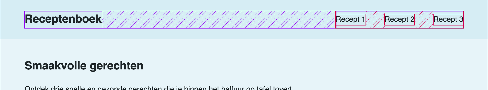
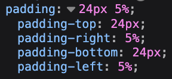
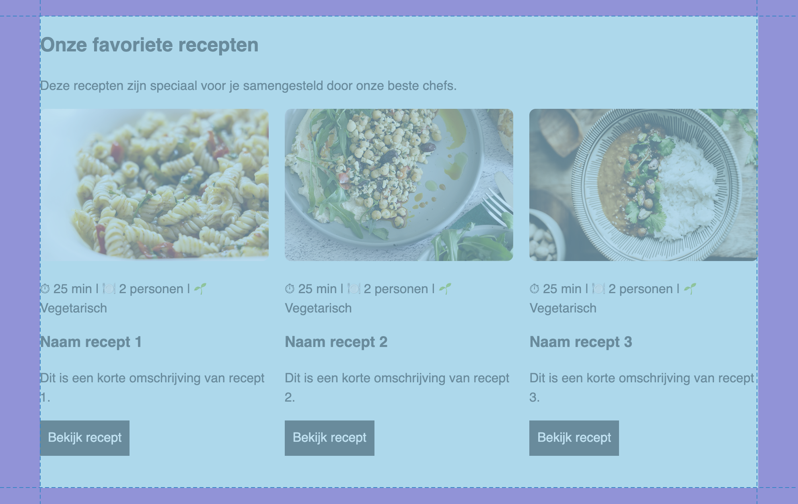
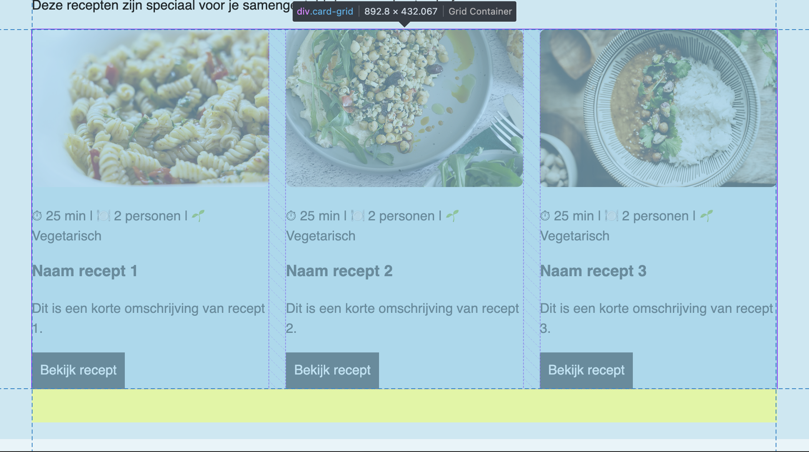
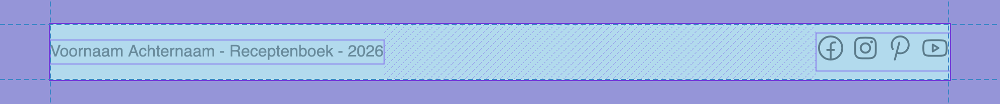
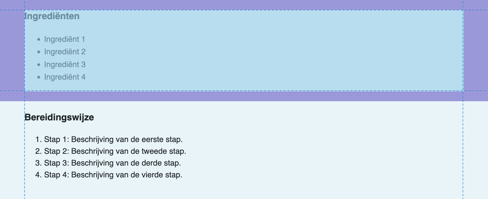

## Briefing & concept

In deze opdracht bouw je een **multipage receptenboek** over een culinair thema naar keuze. Een inspirerend kookplatform is meer dan een opsomming van ingrediënten. Je gebruikt smaakvolle fotografie, een herkenbare visuele sfeer en wervende introteksten om je bezoeker mee te nemen en goesting te geven om de keuken in te duiken.

Je tilt je basiskennis van HTML en CSS naar een hoger niveau door een samenhangende website van vier pagina's te ontwerpen en te ontwikkelen: één centrale startpagina (`index.html`) en drie gedetailleerde receptpagina's (`recept_1.html`, `recept_2.html`, `recept_3.html`), vormgegeven via één centraal stijlblad (`style.css`).

### Inspiratiebronnen

Bekijk onderstaande culinaire websites om te zien hoe platformen recepten, beelden en navigatie presenteren:

* [Dagelijkse Kost](https://dagelijksekost.vrt.be/)
* [Allerhande](https://www.ah.be/allerhande)
* [Njam!](https://njam.tv/)
* [Delicious Magazine](https://deliciousmagazine.nl/)

### Jouw concept

Je bouwt een website bestaande uit **vier HTML-pagina's**:

1. **Landingspagina (`index.html`):** De homepage introduceert jouw culinaire thema en bevat doorklikkaarten naar de drie recepten.
2. **Drie receptpagina's (`recept_1.html`, `recept_2.html`, `recept_3.html`):** Drie detailpagina's die elk één specifiek gerecht uitwerken met een sfeerfoto, gegevens (bereidingstijd, aantal personen), een ingrediëntenlijst en genummerde bereidingsstappen.

Kies een duidelijk overkoepelend thema voor jouw receptenboek. Denk bijvoorbeeld aan: *Snelle doordeweekse pasta's*, *Zoete weekendbaksels*, *Vegetarische comfort food*, *Aziatische street food* of *Gezonde ontbijtgerechten*.

### Technische specificaties

Je website bestaat uit **vier HTML-pagina's** (`index.html` en de drie receptpagina's) die allemaal gekoppeld zijn aan één centraal extern stijlblad (`style.css`). Voor de lay-out combineer je CSS-technieken: het box-model (margin en padding), Flexbox en Grid. Al het beeldmateriaal bewaar je in webformaat (JPG, WebP of PNG) en orden je netjes in de map `images`.

#### Mappenstructuur

Plaats alle bestanden in je OneDrive onder het vak **Web-Story** in een overzichtelijke structuur:

```text
VoornaamA_Receptenboek/
└─ images/
   └─ foto-recept_1.jpg
   └─ foto-recept_2.jpg
   └─ foto-recept_3.jpg
   └─ icon-facebook.svg
   └─ icon-instagram.svg
   └─ icon-pinterest.svg
   └─ icon-youtube.svg
└─ index.html
└─ recept_1.html
└─ recept_2.html
└─ recept_3.html
└─ style.css
```

## Stappenplan

### Onderzoek & inhoud

Verzamel alle benodigde inhoud vóór je begint met coderen.

#### Inspiratie onderzoeken

Naast de vermelde voorbeelden ga je zelf op zoek naar **drie andere culinaire websites** (zoals foodblogs, online kookmagazines of receptenplatformen). Beantwoord in je voorbereidingsdocument voor **elke website** telkens deze vijf vragen:

* Hoe zit de navigatiestructuur en de header in elkaar?
* Hoe zijn de receptkaarten (*) opgebouwd (beeldverhouding, titel, labels voor bereidingstijd of moeilijkheidsgraad)?
* Hoe zijn de ingrediënten en bereidingsstappen visueel geordend op een receptdetailpagina?
* Welke lettertypes en kleuren ondersteunen de sfeer van de website?
* Welke call-to-action knoppen of links zetten de bezoeker aan om door te klikken?

> **Wat is een kaartcomponent (card)?**  
> In UI- en webdesign is een **kaart** (*card*) een zelfstandig, afgebakend onderdeeltje dat alle gerelateerde informatie en acties over één specifiek onderwerp bundelt. Een sfeerbeeld, een duidelijke titel, informatieve labels of badges, een korte beschrijving en een actieknop vormen samen één geheel. Doordat kaarten in een consistent raster worden herhaald, kan een bezoeker vlot door de inhoud scannen. Zie ook: [The Component Gallery](https://component.gallery/components/)

#### Thema & recepten kiezen

Kies jouw centrale thema en selecteer drie recepten die hier inhoudelijk bij aansluiten.

#### Teksten & gegevens verzamelen

Noteer per recept de benodigde gegevens in je voorbereidingsdocument:
* **Landingspagina:** Een wervende hoofdtitel, een korte introductieparagraaf over jouw thema en een korte teaserzin per recept.
* **Per receptpagina:**
  * Titel van het gerecht en een korte inleiding.
  * Metadata: bereidingstijd (bv. 25 min) en porties (bv. 2 personen).
  * Ingrediëntenlijst met exacte hoeveelheden.
  * Genummerde bereidingswijze in duidelijke stappen.
  * Bronvermelding met de websitenaam en link.

#### Beeldmateriaal verzamelen

Zoek aantrekkelijke, rechtenvrije foodfoto's via platforms zoals [Unsplash](https://unsplash.com/) of [Pexels](https://www.pexels.com/), of bewaar kwalitatieve afbeeldingen van de bronwebsite. Bewaar minstens 4 foto's (één sfeerbeeld voor de homepage en één foto per recept). Hernoem de bestanden direct met kleine letters (bijvoorbeeld `recept1-tagliatelle.jpg`) en plaats ze in de map `images/`.

#### Indienen

Dien je voorbereidingsdocument in via de voorziene Smartschool-uploadmap als `.pdf` of `.odt` (`VoornaamA_Receptenboek-Onderzoek.pdf`).

### Wireframing & schetsen

Schets je pagina-indeling gewoon uit op papier of een tablet. Zo bepaal je vooraf de plaats van elk onderdeel en voorkom je verrassingen tijdens het coderen.

#### Landingspagina uitschetsen

Schets de indeling van `index.html`:
* **Header:** Logo of websitetitel links, horizontale navigatielinks naar de recepten rechts.
* **Hero-sectie:** Grote titel, introductie, sfeerbeeld en een opvallende actieknop (`Bekijk de recepten`).
* **Receptenoverzicht:** Een raster met drie kaarten (foto, titel, bereidingstijd en doorkliklink).
* **Footer:** Colofon en copyright.

#### Receptpagina-sjabloon uitschetsen

Ontwerp één vast sjabloon dat je gebruikt voor alle drie de detailpagina's (`recept_1.html`, `recept_2.html`, `recept_3.html`):
* **Header:** Identiek aan de homepage met een actieve status voor de geopende pagina.
* **Titel & metadata:** Naam van het gerecht met badges voor bereidingstijd, personen en korte toelichting.
* **Ingrediënten & foto:** Een side-by-side blok met links de ingrediëntenlijst en rechts de foto van het gerecht.
* **Bereidingswijze:** Genummerde stappen met onderaan de bronvermelding.
* **Footer:** Identiek aan de homepage.

> **Tip:** Noteer bij elk geschetst element meteen de HTML-tag die je zal gebruiken (zoals `<header>`, `<nav>`, `<h1>`, `<article>`, `<ul>`, `<ol>`, ``, `<footer>`).

#### Indienen

Maak een duidelijke foto of scan van je schetsen en dien deze in via de Smartschool-uploadmap (`VoornaamA_Receptenboek-Schetsen.pdf` of `.png`).

### Interactief voorbeeld

Bekijk hieronder het interactieve voorbeeld en demonstratie van het receptenboek. Gebruik de knoppen **Resultaat**, **HTML** en **CSS** om te schakelen tussen de weergave en de onderliggende code. Via de knop **Volledig scherm** (rechtsboven) open je de demo schermvullend met de code aan de rechterkant.



### Basisstructuur

Maak de vier HTML-documenten aan in je projectmap: `index.html`, `recept_1.html`, `recept_2.html` en `recept_3.html`. Maak ook het CSS-bestand `style.css` aan in je projectmap. Zorg ook voor een submap `images`.


Gebruik in VS Code de Emmet-snelkoppeling uitroepteken `(!)` in een leeg HTML-document en druk op `Tab` of `Enter`. Vul de basisstructuur aan met de juiste taal (`nl`), een unieke paginatitel en de koppeling naar het centrale stijlblad.

```html
<!DOCTYPE html>
<html lang="nl">
<head>
  <meta charset="UTF-8">
  <meta name="viewport" content="width=device-width, initial-scale=1.0">
  <title>Receptenboek</title>
  <link rel="stylesheet" href="style.css">
</head>
<body>

</body>
</html>
```

### Algemene stijlen

In `style.css` stel je de globale basisopmaak in voor alle pagina's. Dat houdt in dat je de achtergrondkleur van de pagina instelt, de tekstkleur, de lettertypefamilie.

Verander optioneel ook de regelafstand en de opmaak van hyperlinks.

```css
body {
  margin: 0;
  background-color: #e7f4f9;
  color: #1f272a;
  font-family: sans-serif;
  line-height: 1.5;
}

a {
  color: #1f272a;
  text-decoration: none;
}

a:hover {
  text-decoration: underline;
}
```

* **Standaard browserwitruimte verwijderen:** De browser geeft het `<body>`-element standaard een buitenmarge van enkele pixels. Met `margin: 0;` sluit je header en achtergrond naadloos aan tegen de vensterrand.
* **Leesbaarheid (optioneel):** Met `line-height: 1.5;` geef je teksten voldoende ademruimte tussen de regels.
* **Hyperlinks (optioneel):** Met `text-decoration: none;` verwijder je de standaard onderstreping van links. Via `a:hover` verschijnt de onderlijning zodra de bezoeker met de muis over de link beweegt.

### Header & navigatie met Flexbox

Plaats bovenaan de `<body>` van elke pagina een identieke `<header>`. Deze bevat links de titel van je receptenboek en rechts een `<nav>`-element met links naar de verschillende recepten:

```html
<header>
  <a href="index.html">
    <h1>Receptenboek</h1>
  </a>
  <nav>
    <a href="recept_1.html">Recept 1</a>
    <a href="recept_2.html">Recept 2</a>
    <a href="recept_3.html">Recept 3</a>
  </nav>
</header>
```

#### Flexbox

In `style.css` geef je de header vorm met **Flexbox**. In de cursus vind je meer uitleg over de verschillende functies van Flexbox: [Cursus CSS: Flexbox](/cursus/css/#flexbox).



In het voorbeeld wordt zowel de gehele header een flexbox, als de navigatie die verwerkt zit in de header. Elk met hun eigen eigenschappen: `justify-content`, `align-items` en `gap`.

```css
header {
  display: flex;
  justify-content: space-between;
  background-color: #d6edf4;
  padding: 24px 5%;
}

header nav {
  display: flex;
  align-items: center;
  gap: 40px;
}

header h1 {
  margin: 0;
  font-size: 24px;
}
```

Een element met `display: flex;` verandert in een flexibele container. De directe kind-elementen worden automatisch horizontaal naast elkaar op één rij geplaatst.

* **`justify-content: space-between;`** Duwt de websitetitel links helemaal naar de buitenkant en het menu rechts naar de tegenoverliggende zijde, met alle resterende ruimte ertussen.
* **`align-items: center;`** Linet de navigatielinks verticaal netjes uit in het midden ten opzichte van de titel.
* **`gap: 40px;`** Creëert automatisch een tussenruimte van 40 pixels tussen de onderlinge menu-links.

#### padding en margin

* **Shorthand padding met pixels en percentages:** Met `padding: 24px 5%;` stel je 24 pixels witruimte in aan de boven- en onderkant, en 5% aan de linker- en rechterkant. Dankzij het percentage schaalt de zijruimte flexibel mee met de breedte van de header.
* **`header h1 { }` ontkoppelen van marges:** Browsers geven koptitels standaard een forse boven- en ondermarge. Met `margin: 0;` haal je die marge weg.

Padding (binnenruimte) en margin (buitenruimte) zijn belangrijke eigenschappen in CSS. Aan de hand van `margin` bepaal je de afstand van elementen ten opzichte van elkaar. En met `padding` bepaal je de ruimte tussen de rand en de inhoud van een element. Meer info hierover vind je in de cursus: [Cursus CSS: Box Model](/cursus/css/#box-model)


Beide eigenschappen, `padding` en `margin`, zijn een verkorte versie van hun vier afzonderlijke eigenschappen met `-top`, `-right`, `-bottom` en `-left`. 

Je kunt ook twee waarden doorgeven aan `padding` en `margin`, in dat geval verander je de boven- en onderkant met de eerste waarde, en de linker- en rechterkant met de tweede waarde. Alsook kun je lengte-eenheden door elkaar gebruiken, zoals in het voorbeeld met pixels en percentages. Meer info over lengte-eenheden vind je in de cursus: [Cursus CSS: Eenheden](/cursus/css/#eenheden).



### Landingspagina: main, section's & Grid

De hoofdinhoud (`<main>`) van `index.html` verdeel je thematisch in herkenbare secties met het `<section>`-element. Binnen de receptensectie plaats je de gerechten in een raster van kaarten:

```html
<main>
  <section id="hero">
    <h2>Smaakvolle gerechten</h2>
    <p>Ontdek drie snelle en gezonde gerechten die je binnen het halfuur op tafel tovert.</p>
    <p><a href="#recepten">Ontdek de recepten!</a></p>
  </section>

  <section id="recepten">
    <h2>Onze favoriete recepten</h2>
    <p>Deze recepten zijn speciaal voor je samengesteld door onze beste chefs.</p>
    <div class="card-grid">
      <article class="card">
        
        <p>⏱ 25 min | 🍽 2 personen | 🌱 Vegetarisch</p>
        <h3>Naam recept 1</h3>
        <p>Dit is een korte omschrijving van recept 1.</p>
        <a href="recept_1.html">Bekijk recept</a>
      </article>

      <!-- Voeg hieronder op dezelfde manier je overige receptenkaarten toe (minimaal 3 kaarten in totaal) -->

    </div>
  </section>
</main>
```

#### Secties en achtergrond

In `style.css` geef je de `section`-elementen een consistente binnenruimte. Nu kun je de unieke recepten-section bijvoorbeeld een herkenbare achtergrondkleur meegeven. Dat is het grote voordeel van je `section`-elementen unieke id-kenmerk mee te geven. Je kunt ze vlot doelgericht net wat anders vormgeven. Meer info over id-selectors vind je in de cursus [Cursus CSS: Selectors](/cursus/css/#id-selector).

```css
section {
  padding: 20px 5%;
}

#recepten {
  background-color: #c8e8f2;
}
```

* **Secties groeperen (`<section>`):** Gebruik `<section>` om elk inhoudsblok een eigen zone te geven. Aan de hand van `padding` geef je elke sectie een consistente binnenruimte (20 pixels boven/onder en 5% links/rechts).
* **Afwijkende achtergrondkleur via een ID-selector:** Met het hekje `#` voor het id-kenmerk, geef je doelgericht die ene specifieke sectie bijvoorbeeld een eigen achtergrondtint mee.



#### CSS Grid

Voor het overzicht van de receptenkaarten gebruik je **CSS Grid**. Waar Flexbox vooral uitblinkt in één richting (een rij of een kolom), gebruik je CSS Grid om een tweedimensionaal raster van kolommen en rijen te bouwen.

```css
.card-grid {
  display: grid;
  grid-template-columns: 1fr 1fr 1fr;
  gap: 20px;
  margin-bottom: 40px;
}
```

* **`display: grid;`** Transformeert de container in een raster waarin onderliggende elementen automatisch als rasteritems worden opgesteld.
* **`grid-template-columns: 1fr 1fr 1fr;`** De fractie-eenheid (`fr`) verdeelt de beschikbare ruimte in evenredige delen. Drie keer `1fr` betekent exact drie kolommen van gelijke breedte.
* **`gap: 20px;`** Zorgt voor een uniforme tussenruimte van 20 pixels tussen alle kaarten, zowel horizontaal als verticaal.
* **`margin-bottom: 40px;`** Voorziet extra ademruimte onder het raster zodat de inhoud mooi loskomt van de onderkant van de sectie.



#### Receptenkaarten vormgeven

Tot slot style je de individuele kaarten, afbeeldingen en actieknoppen:

```css
h3 {
  margin-top: 0;
}

main img {
  width: 100%;
  border-radius: 8px;
}

.card a {
  display: block;
  width: fit-content;
  padding: 10px;
  background-color: #1f272a;
  color: #ffffff;
}
```

* **Witruimte beheersen met `h3 { margin-top: 0; }`** Koppen hebben standaard een bovenmarge. Door die op nul te zetten, sluit de titel van het gerecht strak aan onder de bereidingsdetails.
* **Afbeeldingen responsief maken met `main img { }`**
  * Met `width: 100%;` vult elke afbeelding netjes de volledige breedte van de kaartkolom, ongeacht de oorspronkelijke pixelgrootte van de foto.
  * Met `border-radius: 8px;` rond je de hoeken van de afbeelding subtiel af voor een zachte, moderne uitstraling.
* **Van een tekstlink een knop maken met `.card a { }`**
  * Een `<a>`-element is standaard een inline-element. Met `display: block;` en `width: fit-content;` gedraagt de link zich als een compact knopblokje dat exact meegroeit met de lengte van de knoptekst.
  * Met `padding: 10px;`, een donkere achtergrondkleur en witte tekst creëer je een opvallende call-to-action.


### Footer: Eenvoudige herhalende afsluiting

Plaats onderaan elke HTML-pagina dezelfde `<footer>`. Deze bevat minimaal een copyrightvermelding en een groepje pictogrammen die linken naar sociale mediakanalen. Gratis vector-icoontjes kun je downloaden via [SVG Repo](https://www.svgrepo.com/). Het voordeel van SVG (Scalable Vector Graphics) is dat vectorafbeeldingen op elk schermformaat en elke schermresolutie haarscherp blijven en een kleine bestandsgrootte hebben.

```html
<footer>
  <p>Voornaam Achternaam - Receptenboek - 2026</p>
  <div>
    
    
    
    
  </div>
</footer>
```

Net zoals de `<header>` kopieer je deze `<footer>` ongewijzigd naar alle vier de pagina's (`index.html`, `recept_1.html`, `recept_2.html` en `recept_3.html`).

#### Flexbox

In `style.css` style je de footer zoals de header met Flexbox.

```css
footer {
  background-color: #d6edf4;
  padding: 24px 5%;
  display: flex;
  justify-content: space-between;
  align-items: center;
}
```

* **Consistente omkadering:** Met `background-color` en `padding` stem je de achtergrond en binnenruimte exact af op de header. Zo vormen de boven- en onderkant van je website één visueel geheel.
* **`display: flex;`** Transformeert de footer in een flexibele container. De directe kind-elementen, de copyrightparagraaf (`<p>`) en de groep pictogrammen (`<div>`) komen automatisch horizontaal naast elkaar op één rij te staan.
* **`justify-content: space-between;`** Plaatst de tekst uiterst links en de iconengroep uiterst rechts, met alle resterende witruimte daartussen.
* **`align-items: center;`** Linet de tekst en de iconengroep verticaal gecentreerd uit ten opzichte van elkaar.

#### Iconen vormgeven

In de HTML zitten de SVG-pictogrammen samen in een `<div>`. In CSS geef je ze een passend en uniform formaat.

```css
footer img {
  width: 30px;
}
```

* **Iconen groeperen in een `<div>`:** Omdat alle ``-tags samen in één `<div>` zitten, behandelt Flexbox deze groep als één enkel item aan de rechterkant van de footer.
* **Formaat instellen met `footer img { }`** Schaal de SVG-pictogrammen compact en uniform zodat ze een rustig en evenwichtig accent vormen onderaan de pagina.



### Receptenpagina: main, lijsten & CSS-specificiteit

Op de drie receptpagina's (`recept_1.html`, `recept_2.html`, `recept_3.html`) werk je telkens één specifiek gerecht uit. Je behoudt dezelfde `<header>` en `<footer>`, maar richt het `<main>`-gedeelte anders in:

```html
<main>
  <section id="inleiding">
    <h2>Recept 1</h2>
    <p>⏱ 25 min | 🍽 2 personen | 🌱 Vegetarisch</p>
    <p>Hier volgt een korte en duidelijke omschrijving.</p>
    
  </section>

  <section id="ingredienten">
    <h3>Ingrediënten</h3>
    <ul>
      <li>Ingrediënt 1</li>
      <li>Ingrediënt 2</li>
    </ul>
  </section>

  <section id="bereiding">
    <h3>Bereidingswijze</h3>
    <ol>
      <li>Stap 1: Beschrijving van de eerste stap.</li>
      <li>Stap 2: Beschrijving van de tweede stap.</li>
    </ol>
  </section>
</main>
```

#### Secties en indeling

Binnen `<main>` verdeel je de inhoud van het gerecht in drie duidelijke `<section>`-elementen, elk met een eigen `id`.

* **`#inleiding`:** Bevat de recepttitel (`<h2>`), een overzichtsbalk met praktische details (bereidingstijd, porties, dieettype), een korte beschrijving en een aantrekkelijke foto van het afgewerkte gerecht.
* **`#ingredienten`:** Bevat een subtitel (`<h3>`) en de lijst met alle benodigdheden.
* **`#bereiding`:** Bevat een subtitel (`<h3>`) en de stapsgewijze instructies voor het koken.
* **Automatische witruimte:** Omdat je in `style.css` eerder al de algemene regel `section { padding: 20px 5%; }` hebt vastgelegd, krijgen alle drie de secties reeds dezelfde consistente binnenruimte als op de landingspagina.

#### Doelgericht lijstgebruik

Kies steeds het juiste HTML-lijstelement afhankelijk van het type inhoud:

* **Ongeordende lijst (`<ul>`)** Gebruik voor de ingrediënten een ongeordende lijst (`<ul>` met `<li>`). De volgorde waarin ingrediënten worden klaargelegd is immers niet belangrijk.
* **Geordende lijst (`<ol>`)** Gebruik voor de bereidingswijze wel een geordende lijst (`<ol>` met `<li>`). De browser nummert de stappen automatisch (`1.`, `2.`, `3.`), wat overzicht biedt tijdens het koken.

Meer informatie over lijsten vind je in de cursus: [Cursus HTML: Lijst met lijstitems](/cursus/html/#lijst-met-lijstitems).



#### Afbeeldingen en CSS-specificiteit

Op de landingspagina zorgt de stijlregel `main img { width: 100%; border-radius: 8px; }` ervoor dat beelden binnen kaarten de volledige kaartkolom benutten. Op een receptdetailpagina zou een breedte van 100% hier resulteren in een grote schermbrede afbeelding.

In `style.css` kun je daarom een specifiekere regel toevoegen om dit te voorkomen:

```css
/* Stijl voor receptpagina */

#inleiding img {
  max-width: 40%;
}
```

* **`max-width: 40%;`** Begrenst de afbeelding tot maximaal 40% van de beschikbare sectiebreedte, waardoor de foto mooi in balans blijft met de omringende tekst. De foto behoudt wel netjes de afgeronde hoeken.
* **Hoe werkt CSS-specificiteit?** Wanneer twee CSS-stijlregels van toepassing zijn op hetzelfde HTML-element (``), berekent de browser welke selector het zwaarst doorweegt:
  * De tag-selector `main img { }` heeft een lage specificiteit (twee elementnamen).
  * De selector `#inleiding img { }` bevat een uniek ID (`#inleiding`). Een ID-selector weegt veel zwaarder dan gewone tag- of klasseselectors.
* **Resultaat:** De browser geeft voorrang aan `#inleiding img { }`. Op de receptpagina blijft de foto begrensd op maximaal 40% van de paginabreedte, terwijl de kaarten op de landingspagina netjes 100% van hun kolom blijven vullen.

Meer achtergrond over selectors vind je in de cursus: [Cursus CSS: CSS-selectors](/cursus/css/#css-selectors).

### Extra uitdagingen

Ben je klaar met de basis? Maak je receptenboek extra professioneel en verfijnd met de uitbreidingen hieronder.

* **Vaste beeldverhouding met `aspect-ratio` en `object-fit: cover`:** Voorkom dat foto's met verschillende afmetingen het raster ongelijk maken:
  ```css
  .card img {
    aspect-ratio: 3 / 2;
    object-fit: cover;
  }
  ```
  De eigenschap `aspect-ratio: 3 / 2;` forceert een vaste breedte-hoogteverhouding. `object-fit: cover;` zorgt dat het beeld het kader netjes vult en zo nodig subtiel bijsnijdt zonder de foto plat te drukken of uit te rekken.
* **Subtiele scheidingslijnen met `border-bottom` of `border-top`:** Geef je navigatiebalk of secties een strakke scheidingslijn:
  ```css
  header {
    border-bottom: 2px solid #bce1ee;
  }
  ```
* **Lettertypes importeren via Google Fonts of Adobe Fonts:** Vervang het standaard lettertype door een modern webfont met een `@import`-regel helemaal bovenaan je `style.css`:
  ```css
  @import url('https://fonts.googleapis.com/css2?family=Plus+Jakarta+Sans:wght@400;600;700&display=swap');

  body {
    font-family: 'Plus Jakarta Sans', sans-serif;
  }
  ```
* **Relatieve eenheden (`rem` in plaats van `px`):** Vervang vaste pixels voor tekstgroottes en witruimtes door `rem` (bijvoorbeeld `1.5rem` voor 24px of `2rem` voor 32px). Hierdoor schaalt jouw lay-out mee wanneer een gebruiker de tekstgrootte in de browserinstellingen aanpast.
* **Micro-interacties op receptkaarten:** Laat kaarten subtiel omhoog bewegen met een zachte schaduw zodra je er met de muis over beweegt:
  ```css
  .card {
    transition: transform 0.2s ease, box-shadow 0.2s ease;
  }

  .card:hover {
    transform: translateY(-4px);
    box-shadow: 0 8px 16px rgba(0, 0, 0, 0.08);
  }
  ```
* **CSS-variabelen voor themakleuren:** Beheer je kleurenpalet overzichtelijk bovenaan je CSS via `:root`:
  ```css
  :root {
    --bg-hoofd: #e7f4f9;
    --bg-header: #d6edf4;
    --bg-accent: #c8e8f2;
    --tekst-donker: #1f272a;
  }
  ```

## Oplevering

Comprimeer (zip) jouw volledige projectmap `VoornaamA_Receptenboek` en lever het ZIP-bestand in via de Smartschool Uploadzone:

```text
VoornaamA_Receptenboek.zip
└─ images/
   └─ foto-recept_1.jpg
   └─ foto-recept_2.jpg
   └─ foto-recept_3.jpg
   └─ icon-facebook.svg
   └─ icon-instagram.svg
   └─ icon-pinterest.svg
   └─ icon-youtube.svg
└─ index.html
└─ recept_1.html
└─ recept_2.html
└─ recept_3.html
└─ style.css
```

### Checklist

Controleer jouw project grondig aan de hand van deze controlelijst voor je definitief indient.

#### Bestanden & mappen
- De hoofdmap heet exact `VoornaamA_Receptenboek` (jouw eigen voornaam en eerste letter van je achternaam).
- Alle bestandsnamen zijn geschreven in kleine letters, zonder spaties of speciale tekens.
- In de hoofdmap staan `index.html`, `recept_1.html`, `recept_2.html`, `recept_3.html` en `style.css`.
- Alle afbeeldingen en SVG-iconen staan verzameld in de submap `images/`.

#### Voorbereiding & schetsen
- In het voorbereidingsdocument zijn drie zelfgekozen websites onderzocht aan de hand van de vijf vragen en zijn alle receptteksten gebundeld.
- De pagina-indelingen zijn duidelijk uitgeschetst op papier met vermelding van de bijhorende HTML-tags.

#### HTML: Structuur & semantiek
- Alle pagina's bevatten een geldige documentstructuur (`<!DOCTYPE html>`, `<html lang="nl">`, `<head>`, `<body>`).
- Het `<title>`-element is op elke pagina uniek aangepast.
- De `<header>` bevat een werkend navigatiemenu met relatieve links tussen alle vier de pagina's.
- De inhoud is semantisch verdeeld met `<main>`, `<section>`, `<article>`, `<ul>` (ingrediënten), `<ol>` (bereidingsstappen) en `<footer>`.
- Alle afbeeldingen (``) bevatten een werkend relatief pad en een betekenisvol `alt`-kenmerk.

#### CSS: Vormgeving, Flexbox & Grid
- Alle vier de HTML-pagina's linken foutloos naar hetzelfde centrale bestand `style.css`.
- Flexbox is toegepast voor de `<header>` (titel en navigatiemenu) en de `<footer>` (copyright en sociale mediapictogrammen).
- CSS Grid (`grid-template-columns: 1fr 1fr 1fr;` en `gap`) is toegepast voor het overzichtsraster op de homepage.
- CSS-specificiteit (`#inleiding img`) is benut om de receptafbeelding op detailpagina's compacter weer te geven dan op de homepage (`main img`).
- Links binnen kaarten (`.card a`) zijn gestyled als herkenbare knoppen met achtergrondkleur en padding.

#### Kwaliteit & verzorging
- De code is overzichtelijk ingesprongen en vrij van syntaxfouten.
- De website oogt evenwichtig en straalt de sfeer uit van een samenhangend receptenboek.
