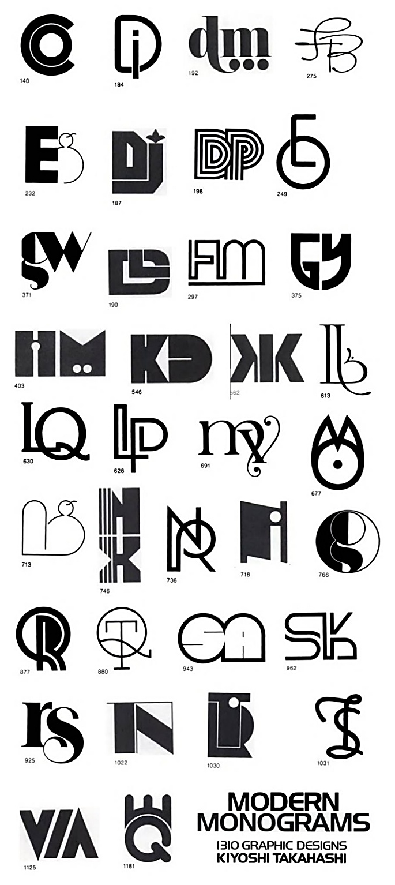

## Briefing & concept

In het vak **Grafische vormgeving** ontwierp je een persoonlijk monogram op basis van de initialen van je eigen naam. In je onderzoeksboek werkte je drie concepten uit in telkens drie opeenvolgende ontwerpfases, lichtte je jouw ideeën mondeling toe en koos je op basis van terugkoppeling één sterk ontwerp voor verdere uitwerking.

In **Motion** breng je dat gekozen monogram tot leven als een **duotoon geanimeerd beeldmerk** in Adobe After Effects. Het resultaat moet vlot inzetbaar zijn als video-intro, social media bumper, persoonlijke branding in je portfolio of als logo van een creatief productiehuis.




### Geometrische vorm naar monogram

De kracht van deze opdracht zit volledig in de **transformatie**. Je eindlogo mag dus niet zomaar op het scherm verschijnen met een simpele *fade-in*, maar moet zichtbaar groeien en opbouwen doorheen de drie stadia uit jouw vooronderzoek:

1. **Geometrische basisvorm:** Je vertrekt vanuit een eenvoudige geometrische vorm (cirkel, vierkant, rechthoek, driehoek of een combinatie) die de verhouding neerzet.
2. **Blokvormige vereenvoudiging:** Vanuit die basisvorm ontwikkelt zich een krachtige, hoekige tussenstructuur met strakkere contouren waarin jouw initialen al herkenbaar vorm krijgen.
3. **Definitief monogram:** De blokstructuur verfijnt zich tot het afgewerkte monogram met een evenwichtige compositie en consistente lijnvoering.

### Duotoon kleurenpalet

Je animeert jouw monogram volledig **duotoon**: je werkt met exact **twee sterk contrasterende kleuren** (één kleur voor de achtergrond en één kleur voor het beeldmerk). Door kleurgebruik bewust eenvoudig te houden, gaat alle aandacht naar vormtaal, ritme en de transitie zelf.

### Technische specificaties

Je werkt jouw monogram digitaal uit in Adobe Illustrator op **A4-formaat liggend**, waarbij je de drie ontwerpfases afzonderlijk bewaart met zuivere vectoren en gescheiden lagen.

In Adobe After Effects animeer je het duotoon beeldmerk op **1920 × 1080 px** (16:9 Full HD) of **1080 × 1080 px** (1:1 vierkant). Stel de framerate in op **30 fps** en mik op een compacte, krachtige animatie van **4 tot 6 seconden**. Het eindresultaat exporteer je via Adobe Media Encoder als een **H.264 MP4-bestand** van maximaal **10 MB**.

### Mappenstructuur

Zet vooraf een ordelijke projectmap op in je OneDrive onder het vak **Motion**:

```text
VoornaamA_Monogram/
└─ 01_assets/
   └─ VoornaamA_Monogram.ai
└─ 02_exports/
   └─ VoornaamA_Monogram-Animatie.mp4
└─ VoornaamA_Monogram-Animatie.aep
```

## Stappenplan

### Schetsen vertalen naar Illustrator

Een vlotte transitie in After Effects begint met een slimme voorbereiding in **Adobe Illustrator**.

#### De drie fases afstemmen op animatie

Bekijk je schetsen van de geometrische basisvorm, de blokvormige tussenfase en het definitieve monogram naast elkaar. Stel jezelf bij elke overgang de vraag *hoe* een vorm kan verschuiven, opsplitsen, doortrekken of vervormen naar de volgende stap.

#### Document, vectorpaden en lagenopbouw

1. Maak in Adobe Illustrator een nieuw document op **A4-formaat liggend** met kleurmodus **RGB** (noodzakelijk voor scherm en video-animatie).
2. Teken **alle drie de ontwerpfases afzonderlijk** (bijvoorbeeld naast elkaar op drie tekengebieden of op duidelijk gescheiden lagen), zodat ze zowel voor Grafische vormgeving (`.ai` en `.pdf`) als voor Motion bruikbaar blijven.
3. **Werk met zuivere ankerpunten:** Gebruik zo weinig mogelijk ankerpunten om je vormen strak te definiëren. Hoe eenvoudiger en properder de vectorpaden zijn opgebouwd, hoe vlotter een vorm straks in After Effects kan overvloeien.
4. **Splits bewegende onderdelen op in hoofdlagen:** After Effects leest enkel de hoofdlagen afzonderlijk in. Zet elk element dat apart moet bewegen, schalen, draaien of opbouwen op een eigen, duidelijk benoemde laag. Onderdelen die los van elkaar inschuiven of wegdraaien, zet je beter op aparte lagen.
5. Bewaar het voorbereide bestand in je map `01_assets/` als `VoornaamA_Monogram.ai`.

### Importeren en voorbereiden in After Effects

1. Start **Adobe After Effects** en sla je project meteen op in de hoofdmap als `VoornaamA_Monogram-Animatie.aep`.
2. Importeer `VoornaamA_Monogram.ai` via **File → Import → File...** (`Ctrl + I` / `Cmd + I`) met **Import Kind: Composition** en **Footage Dimensions: Layer Size** (zie ook [Cursus After Effects: Illustrator importeren](/cursus/after_effects/#bestanden-importeren-illustrator-naar-after-effects)).
3. Maak een nieuwe hoofdcompositie (of stel je geïmporteerde compositie bij via `Ctrl + K` / `Cmd + K`) met resolutie **1920 × 1080 px** (16:9) of **1080 × 1080 px** (1:1), framerate **30 fps** en een duur van **5 seconden** (`0:00:05:00`).
4. Plaats de lagen van je drie fases netjes gecentreerd en schaal ze gelijkmatig op naar het gewenste formaat binnen marges.
5. Voeg onderaan in de tijdlijn een **Solid** toe (**Layer → New → Solid...**, sneltoets `Ctrl + Y` / `Cmd + Y`) in je eerste duotoonkleur als achtergrond.
6. Selecteer de geïmporteerde Illustrator-lagen, klik met de rechtermuisknop en kies **Create → Create Shapes from Vector Layer**. Je vectorlagen worden omgezet in bewerkbare **Shape Layers** waarvan je rechtstreeks de paden, vulling en lijnen kunt animeren. Verberg of verwijder de originele `.ai`-lagen uit de tijdlijn om het overzicht te bewaren.

### De vormtransitie animeren

Combineer afhankelijk van jouw ontwerp één of meerdere van onderstaande technieken om de overgang tussen de geometrische basisvorm, de blokstructuur en het monogram duidelijk te maken.

#### Shape Morphing (paden overvloeien)

Met *Shape Morphing* laat je het vectorpad van een vorm rechtstreeks veranderen in de contouren van een volgende fase (zie [Cursus After Effects: Shape Morphing](/cursus/after_effects/#shape-morphing-vormen-overvloeien)):

1. Klap in de tijdlijn de vormlaag van de beginvorm open naar `Contents > Group > Path 1` en klik op de stopwatch naast `Path` om een beginkeyframe te zetten.
2. Verplaats de tijdindicator naar het moment waarop de tweede fase bereikt is. Open het overeenkomstige `Path 1` van de blokvorm, kopieer dit (`Ctrl + C`) en plak het op het pad van je startlaag (`Ctrl + V`).
3. Herhaal deze stap verderop op de tijdlijn voor het pad van het definitieve monogram.
4. **Tip tegen draaiende vormen:** Ziet de overgang er wat verwrongen uit tijdens het overvloeien? Selecteer het eerste ankerpunt op elk pad met de *Pen Tool* (`G`), klik met de rechtermuisknop en kies **Mask and Shape Path → Set First Vertex**. Zo start After Effects de berekening op overeenkomstige hoeken.

#### Trim Paths & modulaire opbouw

Bestaat jouw monogram (deels) uit strakke lijnen, onderbroken contouren of overlappende stroken?

* Voeg binnen de Shape Layer **Add → Trim Paths** toe en animeer `Start`, `End` en `Offset` om lijnen dynamisch te laten uittekenen, inkorten of doortrekken naar de nieuwe positie.
* Combineer dit met basis-transformaties (*Position*, *Scale*, *Rotation*) zodat losse bouwblokken samenschuiven of kantelen naar het eindbeeld.

#### Timing, dynamiek en duotoonafwerking

* **Geen saaie lineaire beweging:** Selecteer je keyframes en druk op `F9` (**Easy Ease**). Open de **Graph Editor** (`Shift + F3`) en trek de snelheidscurves aan voor versnelling en vertraging.
* **Anticipation & overshoot:** Geef een vorm net vóór de transformatie een kleine tegengestelde impuls (*anticipation*, bv. kort inkrimpen naar 90% vóór een snelle groei) of laat een onderdeel bij aankomst heel even doorschieten voor je eindpositie (*overshoot*).
* **Motion Blur:** Activeer **Motion Blur** zowel per geanimeerde vormlaag als bovenaan in het tijdlijnvenster voor een vloeiende bewegingsonscherpte tijdens snelle overgangen.
* **Duotoon kleurcontrole:** Stel voor alle vormlagen je tweede contrasterende kleur in. Je kunt op het schakelmoment naar het definitieve monogram eventueel een strakke *color swap* uitvoeren (voor- en achtergrondkleur wisselen).

### Extra uitdagingen

Klaar met de kernanimatie en op zoek naar extra verfijning?

* **Naadloze loop:** Laat het definitieve monogram anderhalve seconde helder leesbaar staan en animeer vervolgens een snelle, omgekeerde transitie terug naar de geometrische basisvorm uit het begin, zodat de video eindeloos kan loopen.
* **Sound design:** Zoek subtiele geluidseffecten (*whooshes*, strakke mechanische klikken of een zachte bass-impact) en plaats ze op de exacte transitiemomenten voor extra impact.

### Renderen en exporteren

1. Selecteer je definitieve hoofdcompositie in After Effects en kies **Composition → Add to Adobe Media Encoder Queue...** (`Ctrl + Alt + M` / `Cmd + Option + M`).
2. Kies als formaat **H.264** en bewaar de export als `VoornaamA_Monogram-Animatie.mp4` in je submap `02_exports/`.
3. Controleer of het videobestand vlot afspeelt, haarscherp is en **maximaal 10 MB** groot is.

## Oplevering

Pak je volledige projectmap in als één ZIP-bestand en dien dit tijdig in via de voorziene Smartschool-uploadzone:

```text
VoornaamA_Monogram.zip
└─ 01_assets/
   └─ VoornaamA_Monogram.ai
└─ 02_exports/
   └─ VoornaamA_Monogram-Animatie.mp4
└─ VoornaamA_Monogram-Animatie.aep
```

### Checklist

Controleer voor het indienen elk punt grondig na.

#### Bestanden & mappen
* De projectmap en het archief volgen exact de naamgeving `VoornaamA_Monogram` en `VoornaamA_Monogram.zip`.
* Het Illustrator-bestand staat als `VoornaamA_Monogram.ai` in `01_assets/`.
* Het After Effects-project `VoornaamA_Monogram-Animatie.aep` opent zonder ontbrekende bestanden.
* De video-export staat als `VoornaamA_Monogram-Animatie.mp4` in `02_exports/`.

#### Illustrator & drie ontwerpfases
* Alle drie de ontwikkelingsfasen (geometrische basisvorm, blokvormige tussenfase en definitief monogram) zijn vectorieel en afzonderlijk terug te vinden in het `.ai`-bestand.
* Bewegende onderdelen zijn logisch gescheiden over benoemde hoofdlagen met zuivere ankerpunten.

#### Transitie-animatie & duotoon
* Het eindlogo groeit zichtbaar en dynamisch vanuit de geometrische basisvorm via de blokstructuur (geen eenvoudige fade-in).
* De bewegingen verlopen vloeiend met *Easy Ease*, doordachte snelheidscurves en *Motion Blur*.
* De volledige animatie werkt consequent binnen één helder, contrastrijk duotoon kleurenpalet.

#### Technische export
* Resolutie is exact **1920 × 1080 px** (16:9) of **1080 × 1080 px** (1:1) aan **30 fps**.
* De duur bedraagt ongeveer **4 tot 6 seconden** zonder storende haperingen of lege eindframes.
* De geëxporteerde H.264 MP4-video is haarscherp en kleiner dan **10 MB**.

